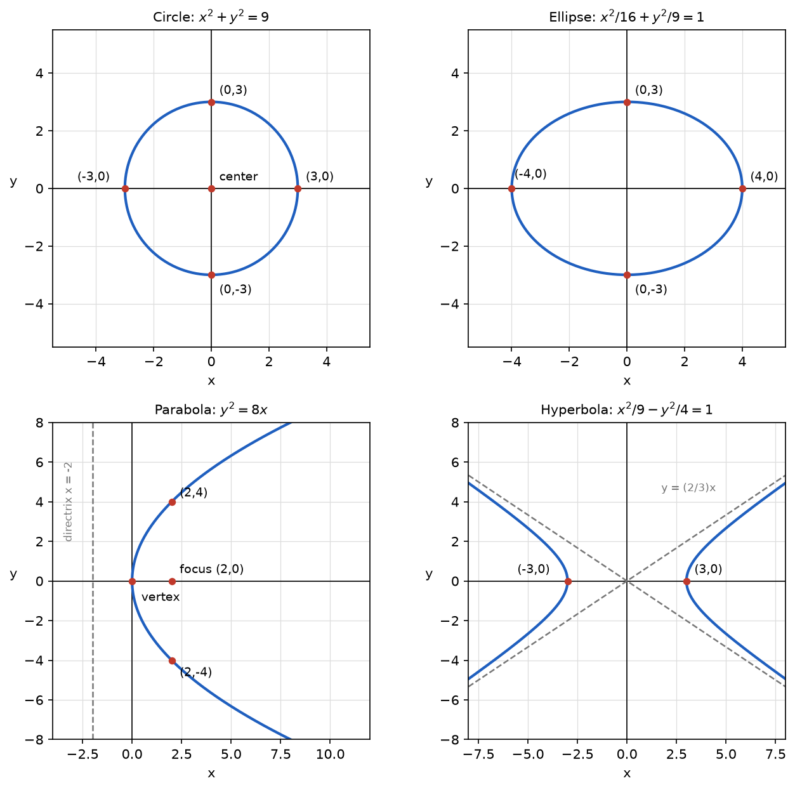

# Problem 1. Recognizing Curves from Canonical Form

## Exercise

### Exercise 1. Recognizing Curves from Canonical Form
Recognize the curves

$$
x^2+y^2=9,
$$

$$
\frac{x^2}{16}+\frac{y^2}{9}=1,
$$

$$
y^2=8x,
$$

$$
\frac{x^2}{9}-\frac{y^2}{4}=1.
$$

For each one, identify the most important features and make a sketch. Explain which parts of the equation let you recognize the type of curve.

> **Why this exercise:** builds the basic dictionary: canonical equation → type of curve → shape and scale.

---

## Answer

| Equation | Curve | Most important features |
|---|---|---|
| $x^2+y^2=9$ | circle | center $(0,0)$, radius $3$ |
| $\frac{x^2}{16}+\frac{y^2}{9}=1$ | ellipse | center $(0,0)$, semiaxes $4$ along $x$ and $3$ along $y$ |
| $y^2=8x$ | parabola | vertex $(0,0)$, axis of symmetry $y=0$, opens to the right |
| $\frac{x^2}{9}-\frac{y^2}{4}=1$ | hyperbola | center $(0,0)$, vertices $(\pm3,0)$, asymptotes $y=\pm\frac23x$ |

The type is recognized from the squared terms:

- both squares with equal positive coefficients: circle,
- both squares with different positive coefficients: ellipse,
- only one variable squared: parabola,
- both squares with opposite signs: hyperbola.

---

## Sketch

The sketch shows each curve with the points that fix its scale: the four axis points of the circle and of the ellipse, the vertex and focus of the parabola, and the two vertices and two asymptotes of the hyperbola.

---

## Steps

### Step 1. Circle

$$
x^2+y^2=9=3^2
$$

The equation has the form $x^2+y^2=r^2$, so it describes all points at distance $r=3$ from the origin.

- Center: $(0,0)$.
- Radius: $3$.
- Axis points: $(\pm3,0)$ and $(0,\pm3)$.

### Step 2. Ellipse

$$
\frac{x^2}{16}+\frac{y^2}{9}=\frac{x^2}{4^2}+\frac{y^2}{3^2}=1
$$

The equation has the form $\frac{x^2}{a^2}+\frac{y^2}{b^2}=1$ with $a=4$ and $b=3$.

- Center: $(0,0)$.
- Semiaxes: $4$ along the $x$-axis and $3$ along the $y$-axis.
- Axis points: $(\pm4,0)$ and $(0,\pm3)$.
- The longer axis is horizontal, because the larger denominator is under $x^2$.

### Step 3. Parabola

$$
y^2=8x
$$

Only $y$ is squared. Since $y^2\ge0$, the curve exists only for $x\ge0$.

- Vertex: $(0,0)$.
- Axis of symmetry: the $x$-axis, because replacing $y$ by $-y$ does not change the equation.
- Opening direction: to the right.
- Scale: comparing with $y^2=4px$ gives $p=2$, so the focus is $(2,0)$ and the directrix is $x=-2$.
- Points for the sketch: $x=2$ gives $y^2=16$, so $(2,4)$ and $(2,-4)$.

### Step 4. Hyperbola

$$
\frac{x^2}{9}-\frac{y^2}{4}=\frac{x^2}{3^2}-\frac{y^2}{2^2}=1
$$

The equation has the form $\frac{x^2}{a^2}-\frac{y^2}{b^2}=1$ with $a=3$ and $b=2$.

- Center: $(0,0)$.
- Vertices: $y=0$ gives $x^2=9$, so $(\pm3,0)$.
- No points on the $y$-axis: $x=0$ gives $-\frac{y^2}{4}=1$, which is impossible.
- Asymptotes: $y=\pm\frac{b}{a}x=\pm\frac23x$.
- The curve has two separate branches, opening to the left and to the right.

---

## Why it works

**The signs of the squares decide the type.** A sum of two positive squares equal to a positive constant bounds both variables, so the curve is closed: a circle or an ellipse. A difference of squares allows both variables to grow together without limit, so the curve is unbounded and splits into two branches: a hyperbola. If one variable appears only to the first power, the curve is closed on one side and open on the other: a parabola.

**The denominators decide the scale.** In $\frac{x^2}{a^2}+\frac{y^2}{b^2}=1$ the substitution $y=0$ gives $x=\pm a$, and $x=0$ gives $y=\pm b$. The square roots of the denominators are therefore the distances from the center to the curve along the axes. A circle is the special case $a=b$.

**The positive term decides the orientation of a hyperbola.** The variable with the positive sign is the one that can stand alone: setting the other to zero still leaves a solvable equation. Here $x^2$ is positive, so the vertices lie on the $x$-axis.

**The first-power variable decides the orientation of a parabola.** The squared variable takes both signs, which gives the symmetry. The first-power variable must stay nonnegative, which gives the opening direction.

---

## Check

One point of each curve is substituted into its equation.

$$
(0,3):\ 0+9=9\ \checkmark
$$

$$
(4,0):\ \frac{16}{16}+0=1\ \checkmark
$$

$$
(2,4):\ 4^2=16=8\cdot2\ \checkmark
$$

$$
(3,0):\ \frac99-0=1\ \checkmark
$$

A point off the axes confirms the ellipse and the hyperbola. For the ellipse, $x=2$ gives $y^2=9\left(1-\frac{4}{16}\right)=\frac{27}{4}$, so $y\approx\pm2.60$, which lies between $-3$ and $3$ ✓. For the hyperbola, $x=5$ gives $y^2=4\left(\frac{25}{9}-1\right)=\frac{64}{9}$, so $y=\pm\frac83\approx\pm2.67$, which is below the asymptote value $\frac23\cdot5\approx3.33$ ✓.
