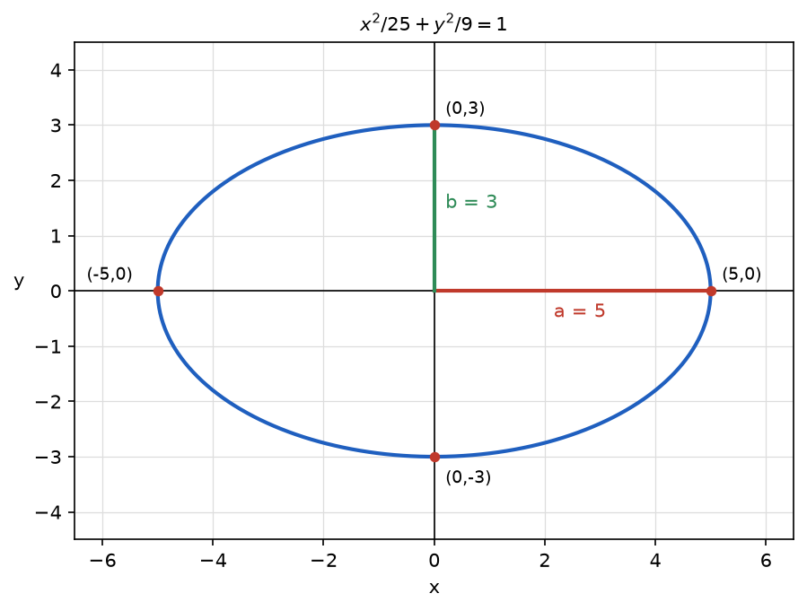

# Problem 3. Ellipse

## Exercise

### Exercise 3. Ellipse
For

$$
\frac{x^2}{25}+\frac{y^2}{9}=1,
$$

find the semiaxis lengths, the intercepts with the coordinate axes, and make a sketch. Explain along which axis the ellipse is more stretched and how this is visible in the equation.

> **Why this exercise:** teaches how to read the size and orientation of an ellipse without additional conceptual machinery.

---

## Answer

- Semiaxes: $a=5$ along the $x$-axis and $b=3$ along the $y$-axis.
- Intercepts with the $x$-axis: $(5,0)$ and $(-5,0)$.
- Intercepts with the $y$-axis: $(0,3)$ and $(0,-3)$.
- The ellipse is more stretched along the $x$-axis. This is visible in the equation because the larger denominator, $25$, stands under $x^2$.

---

## Sketch

The sketch shows the ellipse centered at the origin, passing through the four intercepts. Its total width is $10$ and its total height is $6$.

---

## Steps

### Step 1. Semiaxes

$$
\frac{x^2}{25}+\frac{y^2}{9}=\frac{x^2}{5^2}+\frac{y^2}{3^2}=1
$$

The equation has the form $\frac{x^2}{a^2}+\frac{y^2}{b^2}=1$, so

$$
a=5,\qquad b=3
$$

### Step 2. Intercepts with the $x$-axis

On the $x$-axis $y=0$:

$$
\frac{x^2}{25}=1\quad\Longrightarrow\quad x=\pm5
$$

### Step 3. Intercepts with the $y$-axis

On the $y$-axis $x=0$:

$$
\frac{y^2}{9}=1\quad\Longrightarrow\quad y=\pm3
$$

### Step 4. Sketch

The four intercepts are marked and joined by a smooth closed curve that is symmetric about both axes. One additional point improves the shape: for $x=3$,

$$
\frac{y^2}{9}=1-\frac{9}{25}=\frac{16}{25}\quad\Longrightarrow\quad y=\pm\frac{12}{5}=\pm2.4
$$

### Step 5. Direction of stretching

The ellipse reaches $5$ units from the center along the $x$-axis and only $3$ units along the $y$-axis. It is more stretched along the $x$-axis.

---

## Why it works

**Each term is at most 1.** Both terms on the left are nonnegative and their sum is $1$, so

$$
\frac{x^2}{25}\le1,\qquad \frac{y^2}{9}\le1
$$

which gives $|x|\le5$ and $|y|\le3$. The denominators set the limits of the curve: the larger the denominator, the farther the curve can reach in that direction. This is why the larger denominator marks the longer axis.

**An ellipse is a stretched circle.** The substitution $x=5u$, $y=3v$ turns the equation into $u^2+v^2=1$, the unit circle. The ellipse is the unit circle stretched by the factor $5$ horizontally and by the factor $3$ vertically. The stretch factors are the semiaxes.

**Symmetry.** The variables appear only as squares, so replacing $x$ by $-x$ or $y$ by $-y$ does not change the equation. The curve is symmetric about both coordinate axes, and one quarter of it determines the whole sketch.

---

## Check

The four intercepts satisfy the equation:

$$
(\pm5,0):\ \frac{25}{25}+0=1\ \checkmark,\qquad (0,\pm3):\ 0+\frac99=1\ \checkmark
$$

The additional point lies on the curve:

$$
\left(3,\frac{12}{5}\right):\ \frac{9}{25}+\frac{144}{25\cdot9}=\frac{9}{25}+\frac{16}{25}=1\ \checkmark
$$

A point beyond the semiaxis gives no solution. For $x=6$,

$$
\frac{y^2}{9}=1-\frac{36}{25}=-\frac{11}{25}
$$

which is negative, so the curve has no points with $x=6$ ✓.
