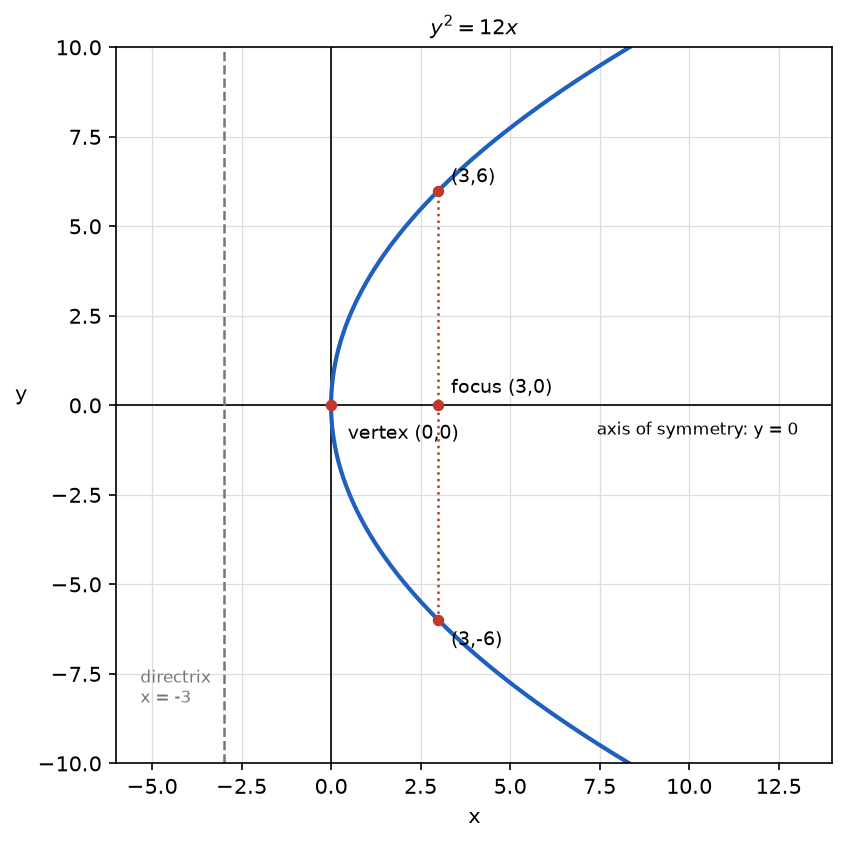

# Problem 4. Parabola

## Exercise

### Exercise 4. Parabola
For

$$
y^2=12x,
$$

identify the vertex, axis of symmetry, and opening direction. Find points on the parabola for $x=3$ and use them to make a sketch.

> **Why this exercise:** teaches how to move from the equation of a parabola to its basic geometry.

---

## Answer

- Vertex: $(0,0)$.
- Axis of symmetry: the $x$-axis, $y=0$.
- Opening direction: to the right, in the direction of positive $x$.
- Points for $x=3$: $(3,6)$ and $(3,-6)$.

---

## Sketch

The sketch shows the parabola starting at the vertex $(0,0)$ and passing through $(3,6)$ and $(3,-6)$. The two branches are mirror images of each other in the $x$-axis and widen as $x$ grows.

---

## Steps

### Step 1. Opening direction

The left side satisfies $y^2\ge0$, so the right side must satisfy

$$
12x\ge0\quad\Longrightarrow\quad x\ge0
$$

The curve lies entirely in the half-plane $x\ge0$ and extends without bound as $x$ grows. It opens to the right.

### Step 2. Vertex

The smallest possible value of $x$ is $0$, and it gives $y^2=0$, so $y=0$. The vertex is $(0,0)$. It is the only point of the curve on the line $x=0$.

### Step 3. Axis of symmetry

Replacing $y$ by $-y$ leaves the equation unchanged, since $(-y)^2=y^2$. If $(x,y)$ is on the curve, then $(x,-y)$ is on it as well. The axis of symmetry is the $x$-axis.

### Step 4. Points for $x=3$

$$
y^2=12\cdot3=36\quad\Longrightarrow\quad y=\pm6
$$

The points are $(3,6)$ and $(3,-6)$.

### Step 5. Sketch

The vertex and the two points are marked and joined by a smooth curve that is symmetric about the $x$-axis. Two more points make the shape more accurate:

$$
x=\frac34:\ y^2=9,\ y=\pm3,\qquad x=\frac{4}{3}:\ y^2=16,\ y=\pm4
$$

---

## Why it works

**The squared variable gives the symmetry.** The variable $y$ appears only as $y^2$, so its sign does not matter. Each allowed value of $x$ except $0$ corresponds to two points, one above the axis and one below it.

**The first-power variable gives the direction.** The variable $x$ appears to the first power, so its sign matters. Only one sign is allowed, which makes the curve one-sided. The coefficient $12$ is positive, so the allowed side is $x\ge0$. The equation $y^2=-12x$ would open to the left.

**The coefficient gives the width.** Solving for $y$ gives $y=\pm\sqrt{12x}$. The height grows like a square root: quadrupling $x$ only doubles $y$. A larger coefficient gives a wider parabola at the same $x$.

**Meaning of the points for $x=3$.** In the standard form $y^2=4px$ the coefficient gives $4p=12$, so $p=3$. The focus is $(3,0)$ and the directrix is $x=-3$. The line $x=3$ passes through the focus, so the points $(3,\pm6)$ are the ends of the chord through the focus perpendicular to the axis. Its length is $12=4p$.

---

## Check

Both points satisfy the equation:

$$
(3,6):\ 6^2=36=12\cdot3\ \checkmark,\qquad (3,-6):\ (-6)^2=36=12\cdot3\ \checkmark
$$

The point $(3,6)$ is equally far from the focus $(3,0)$ and the directrix $x=-3$, as the definition of a parabola requires:

$$
\sqrt{(3-3)^2+(6-0)^2}=6,\qquad 3-(-3)=6\ \checkmark
$$

The vertex has the same property: its distance to the focus is $3$ and its distance to the directrix is $3$ ✓.

No point exists on the left side. For $x=-1$ the equation gives $y^2=-12$, which has no real solution ✓.
