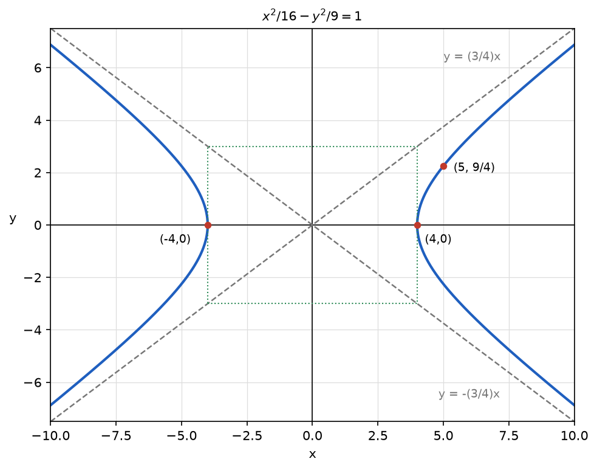

# Problem 5. Hyperbola and Asymptotes

## Exercise

### Exercise 5. Hyperbola and Asymptotes
For

$$
\frac{x^2}{16}-\frac{y^2}{9}=1,
$$

find the intercepts with the $x$-axis, the asymptotes, and make a sketch. Explain why the asymptotes describe the behavior of the curve far from the center.

> **Why this exercise:** shows the role of asymptotes in understanding the global shape of a hyperbola.

---

## Answer

- Intercepts with the $x$-axis: $(4,0)$ and $(-4,0)$.
- Asymptotes: $y=\frac34x$ and $y=-\frac34x$.
- There are no intercepts with the $y$-axis.

Far from the center the constant $1$ becomes negligible compared with the two squared terms, so the curve approaches the pair of lines $\frac{x^2}{16}-\frac{y^2}{9}=0$.

---

## Sketch

The sketch shows two branches. The right branch starts at $(4,0)$ and the left branch at $(-4,0)$. Each branch bends away from the $y$-axis and approaches the dashed asymptotes without touching them. The dotted rectangle with corners $(\pm4,\pm3)$ has the asymptotes as its diagonals.

---

## Steps

### Step 1. Parameters

$$
\frac{x^2}{16}-\frac{y^2}{9}=\frac{x^2}{4^2}-\frac{y^2}{3^2}=1,\qquad a=4,\qquad b=3
$$

### Step 2. Intercepts with the $x$-axis

For $y=0$:

$$
\frac{x^2}{16}=1\quad\Longrightarrow\quad x=\pm4
$$

### Step 3. No intercepts with the $y$-axis

For $x=0$:

$$
-\frac{y^2}{9}=1\quad\Longrightarrow\quad y^2=-9
$$

There is no real solution. The curve does not cross the $y$-axis, so it consists of two separate branches.

### Step 4. Asymptotes

Replacing the right side by $0$ gives the equation of the asymptotes:

$$
\frac{x^2}{16}-\frac{y^2}{9}=0\quad\Longrightarrow\quad \left(\frac{x}{4}-\frac{y}{3}\right)\left(\frac{x}{4}+\frac{y}{3}\right)=0\quad\Longrightarrow\quad y=\pm\frac34x
$$

### Step 5. Sketch

1. The vertices $(\pm4,0)$ are marked.
2. The rectangle with corners $(\pm4,\pm3)$ is drawn. Its diagonals are the asymptotes.
3. Each branch starts at a vertex and approaches the asymptotes.

One additional point fixes the curvature: for $x=5$,

$$
\frac{y^2}{9}=\frac{25}{16}-1=\frac{9}{16}\quad\Longrightarrow\quad y=\pm\frac94
$$

---

## Why it works

**Where the curve exists.** Solving for $y$ gives

$$
y=\pm\frac34\sqrt{x^2-16}
$$

The square root requires $|x|\ge4$. The strip between $x=-4$ and $x=4$ contains no points of the curve, which separates the two branches.

**Why the asymptotes are approached.** In the first quadrant the vertical gap between the asymptote and the curve is

$$
\frac34x-\frac34\sqrt{x^2-16}=\frac34\cdot\frac{x^2-(x^2-16)}{x+\sqrt{x^2-16}}=\frac{12}{x+\sqrt{x^2-16}}
$$

The numerator is the constant $12$ and the denominator grows without bound, so the gap tends to $0$ as $x$ grows. The gap is positive for every $x$, so the curve stays below the asymptote and never reaches it.

**The same idea without a formula.** Dividing the equation by $x^2$ gives

$$
\frac{1}{16}-\frac{1}{9}\cdot\frac{y^2}{x^2}=\frac{1}{x^2}
$$

For large $|x|$ the right side is close to $0$, so $\frac{y^2}{x^2}$ is close to $\frac{9}{16}$ and the slope $\frac{y}{x}$ is close to $\pm\frac34$. Far from the center, the hyperbola cannot be distinguished from the two lines.

**Role of the asymptotes.** The vertices describe the curve near the center. The asymptotes describe it far away. Together they determine the whole shape, which is why a good sketch needs only these two elements.

---

## Check

The vertices and the additional point satisfy the equation:

$$
(\pm4,0):\ \frac{16}{16}-0=1\ \checkmark,\qquad \left(5,\frac94\right):\ \frac{25}{16}-\frac{81}{16\cdot9}=\frac{25}{16}-\frac{9}{16}=1\ \checkmark
$$

The gap formula agrees with a direct calculation. At $x=5$ the asymptote has height $\frac{15}{4}$ and the curve has height $\frac94$:

$$
\frac{15}{4}-\frac94=\frac32,\qquad \frac{12}{5+3}=\frac32\ \checkmark
$$

The gap decreases as $x$ grows:

| $x$ | $5$ | $10$ | $20$ | $100$ |
|---|---|---|---|---|
| gap | $1.5$ | $\approx0.63$ | $\approx0.30$ | $\approx0.06$ |

The asymptotes do not meet the curve. Substituting $y=\frac34x$ into the left side gives $\frac{x^2}{16}-\frac{x^2}{16}=0\neq1$ ✓.
