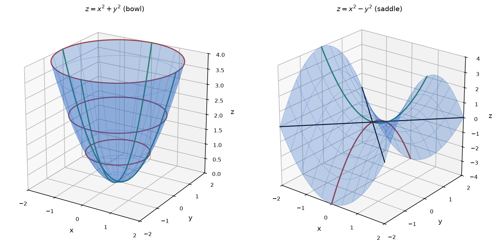

# Problem 10. Paraboloids

## Exercise

### Exercise 10. Paraboloids
Compare

$$
z=x^2+y^2
$$

and

$$
z=x^2-y^2.
$$

For each surface, describe the cross-sections $x=0$, $y=0$, and $z=c$, then make a qualitative sketch.

> **Why this exercise:** teaches how to distinguish two basic types of paraboloids from their cross-sections.

---

## Answer

| Cross-section | $z=x^2+y^2$ | $z=x^2-y^2$ |
|---|---|---|
| $x=0$ | parabola $z=y^2$, opens upward | parabola $z=-y^2$, opens downward |
| $y=0$ | parabola $z=x^2$, opens upward | parabola $z=x^2$, opens upward |
| $z=c$, $c\gt0$ | circle of radius $\sqrt{c}$ | hyperbola $x^2-y^2=c$, opens along $x$ |
| $z=0$ | the point $(0,0)$ | two lines $y=\pm x$ |
| $z=c$, $c\lt0$ | empty | hyperbola $y^2-x^2=-c$, opens along $y$ |

- The first surface is a bowl with its lowest point at the origin: an elliptic paraboloid, here a paraboloid of revolution.
- The second surface is a saddle: a hyperbolic paraboloid. The origin is the lowest point in the $x$-direction and the highest point in the $y$-direction.

---

## Sketch

In the left sketch the horizontal cross-sections are circles that grow with height, and both vertical cross-sections are upward parabolas. In the right sketch one vertical parabola opens upward and the other opens downward. The two straight lines are the cross-section $z=0$.

---

## Steps

### Step 1. Surface $z=x^2+y^2$, vertical cross-sections

$$
x=0:\ z=y^2,\qquad y=0:\ z=x^2
$$

Both are parabolas with vertex at the origin, opening upward.

### Step 2. Surface $z=x^2+y^2$, horizontal cross-sections

$$
x^2+y^2=c
$$

- For $c\gt0$: a circle of radius $\sqrt{c}$ centered on the $z$-axis.
- For $c=0$: the single point $(0,0,0)$.
- For $c\lt0$: no points, because $x^2+y^2\ge0$.

The radius grows with height: $c=1$ gives radius $1$, and $c=4$ gives radius $2$.

### Step 3. Surface $z=x^2-y^2$, vertical cross-sections

$$
x=0:\ z=-y^2,\qquad y=0:\ z=x^2
$$

The first parabola opens downward and the second opens upward. Both have their vertex at the origin.

### Step 4. Surface $z=x^2-y^2$, horizontal cross-sections

$$
x^2-y^2=c
$$

- For $c\gt0$: a hyperbola with vertices $(\pm\sqrt{c},0)$, opening along the $x$-axis.
- For $c=0$: the equation $(x-y)(x+y)=0$, which is the pair of lines $y=x$ and $y=-x$.
- For $c\lt0$: the hyperbola $y^2-x^2=-c$ with vertices $(0,\pm\sqrt{-c})$, opening along the $y$-axis.

A cross-section exists for every value of $c$.

### Step 5. Qualitative shape

- First surface: every vertical section rises from the origin and every horizontal section is a closed curve. The surface is a bowl.
- Second surface: it rises along the $x$-axis and falls along the $y$-axis. The surface is a saddle.

---

## Why it works

**One sign changes everything.** The two equations differ only in the sign of $y^2$. This sign decides whether the two vertical parabolas bend the same way or in opposite ways.

- Same direction: the origin is a minimum, and the surface closes around the $z$-axis.
- Opposite directions: the origin is neither a minimum nor a maximum. It is a saddle point.

**The horizontal sections follow from the sign.** A sum of squares equal to a constant is a closed curve and requires a nonnegative constant. A difference of squares equal to a constant is a hyperbola and allows any constant. The first surface exists only for $z\ge0$, and the second extends to all heights.

**Why the hyperbolas switch direction.** In $x^2-y^2=c$ the variable with the positive sign after rearranging carries the vertices. For $c\gt0$ this is $x$, and for $c\lt0$ it is $y$. The switch happens at $c=0$, where the hyperbola degenerates into its own asymptotes $y=\pm x$.

**Names.** The names come from the horizontal sections: circles or ellipses give an elliptic paraboloid, and hyperbolas give a hyperbolic paraboloid. The word paraboloid refers to the vertical sections, which are parabolas for both surfaces.

---

## Check

Points taken from the cross-sections satisfy the surface equations.

First surface, the point $(1,1,2)$ on the circle of radius $\sqrt2$ at height $2$:

$$
1^2+1^2=2\ \checkmark
$$

Second surface, the point $(2,1,3)$ on the hyperbola $x^2-y^2=3$:

$$
2^2-1^2=3\ \checkmark
$$

Second surface, the point $(1,2,-3)$ on the hyperbola $y^2-x^2=3$:

$$
1^2-2^2=-3\ \checkmark
$$

Second surface, the point $(2,2,0)$ on the line $y=x$:

$$
2^2-2^2=0\ \checkmark
$$

The saddle behavior at the origin is confirmed by nearby values of $z=x^2-y^2$. Moving along $x$ raises the surface and moving along $y$ lowers it:

$$
(0.1,\ 0):\ z=0.01\gt0,\qquad (0,\ 0.1):\ z=-0.01\lt0\ \checkmark
$$
