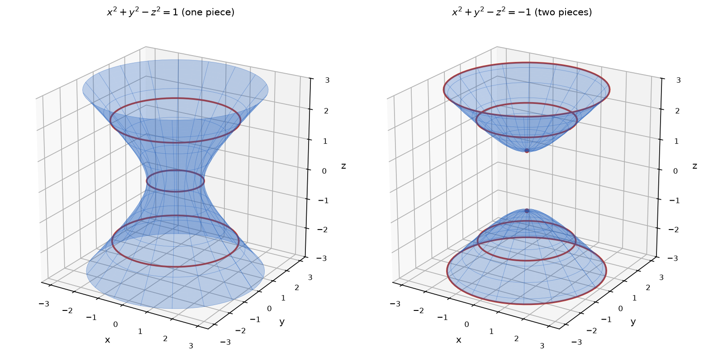

# Problem 11. Two Similar Surfaces

## Exercise

### Exercise 11. Two Similar Surfaces
Compare

$$
x^2+y^2-z^2=1
$$

and

$$
x^2+y^2-z^2=-1.
$$

For several values $z=c$, check whether the cross-section exists and what its radius is. Based on this, describe qualitatively the difference between the surfaces and make sketches.

> **Why this exercise:** teaches how to recognize the shape of a surface from cross-sections instead of from a memorized catalog of names.

---

## Answer

| $c$ | Section of $x^2+y^2-z^2=1$ | Section of $x^2+y^2-z^2=-1$ |
|---|---|---|
| $0$ | circle, radius $1$ | does not exist |
| $\pm\frac12$ | circle, radius $\approx1.12$ | does not exist |
| $\pm1$ | circle, radius $\sqrt2\approx1.41$ | one point |
| $\pm2$ | circle, radius $\sqrt5\approx2.24$ | circle, radius $\sqrt3\approx1.73$ |
| $\pm3$ | circle, radius $\sqrt{10}\approx3.16$ | circle, radius $\sqrt8\approx2.83$ |

- The first surface has a cross-section at every height. It is one connected piece, narrowest at $z=0$, widening upward and downward.
- The second surface has no points for $|z|\lt1$. It consists of two separate pieces, one starting at $(0,0,1)$ and opening upward, the other starting at $(0,0,-1)$ and opening downward.

---

## Sketch

The left sketch shows a single surface shaped like a cooling tower, with the smallest circle at $z=0$. The right sketch shows two separate bowls facing away from each other, with an empty gap between $z=-1$ and $z=1$.

---

## Steps

### Step 1. Cross-sections of the first surface

Substituting $z=c$ into $x^2+y^2-z^2=1$:

$$
x^2+y^2=1+c^2
$$

The right side is at least $1$ for every $c$, so the section always exists. It is a circle centered on the $z$-axis with radius

$$
r_1(c)=\sqrt{1+c^2}
$$

### Step 2. Cross-sections of the second surface

Substituting $z=c$ into $x^2+y^2-z^2=-1$:

$$
x^2+y^2=c^2-1
$$

The right side must be nonnegative:

- for $|c|\lt1$ it is negative and there is no section,
- for $|c|=1$ it is $0$ and the section is the single point $(0,0,\pm1)$,
- for $|c|\gt1$ the section is a circle with radius

$$
r_2(c)=\sqrt{c^2-1}
$$

### Step 3. Evaluate for several heights

$$
r_1(0)=1,\qquad r_1(1)=\sqrt2,\qquad r_1(2)=\sqrt5,\qquad r_1(3)=\sqrt{10}
$$

$$
r_2(1)=0,\qquad r_2(2)=\sqrt3,\qquad r_2(3)=\sqrt8
$$

The radii depend only on $c^2$, so the heights $c$ and $-c$ give the same section.

### Step 4. Describe the shapes

**First surface.** The radius is smallest at $c=0$ and grows in both directions. The circles are stacked without interruption, so the surface is connected. It is a hyperboloid of one sheet.

**Second surface.** No circles exist in the layer between $z=-1$ and $z=1$. Above and below this layer the circles start from a point and grow. The surface has two separate parts. It is a hyperboloid of two sheets.

---

## Why it works

**The sign of the right side decides whether the surface is connected.** Writing both equations as $x^2+y^2=z^2\pm1$ shows the mechanism. The left side is a squared radius and cannot be negative.

- With $+1$ the right side is always positive, so every height is allowed.
- With $-1$ the right side is negative near $z=0$, so a layer of heights is forbidden.

**Both surfaces approach the same cone.** For large $|c|$ the constant $\pm1$ is negligible compared with $c^2$, and both radii are close to $|c|$:

$$
\sqrt{c^2+1}\approx|c|,\qquad \sqrt{c^2-1}\approx|c|
$$

The surface between them is the cone $x^2+y^2=z^2$, whose sections have radius exactly $|c|$. The first surface lies outside this cone and the second lies inside it:

$$
\sqrt{c^2-1}\lt|c|\lt\sqrt{c^2+1}
$$

**Vertical cross-sections explain the names.** The plane $y=0$ gives $x^2-z^2=1$ for the first surface and $z^2-x^2=1$ for the second. Both are hyperbolas. The first opens along the $x$-axis and its two branches are joined by the circles into one sheet. The second opens along the $z$-axis and its branches stay apart, giving two sheets.

---

## Check

A point of each computed section satisfies the corresponding equation.

First surface, the point $(\sqrt5,0,2)$:

$$
5+0-4=1\ \checkmark
$$

Second surface, the point $(\sqrt3,0,2)$:

$$
3+0-4=-1\ \checkmark
$$

Second surface, the lowest point of the upper piece, $(0,0,1)$:

$$
0+0-1=-1\ \checkmark
$$

The gap is confirmed at $z=0$. The second equation becomes $x^2+y^2=-1$, which has no real solution ✓.

At every height the two squared radii differ by exactly $2$:

$$
r_1^2-r_2^2=(1+c^2)-(c^2-1)=2
$$

For $c=2$: $5-3=2$ ✓. For $c=3$: $10-8=2$ ✓.
