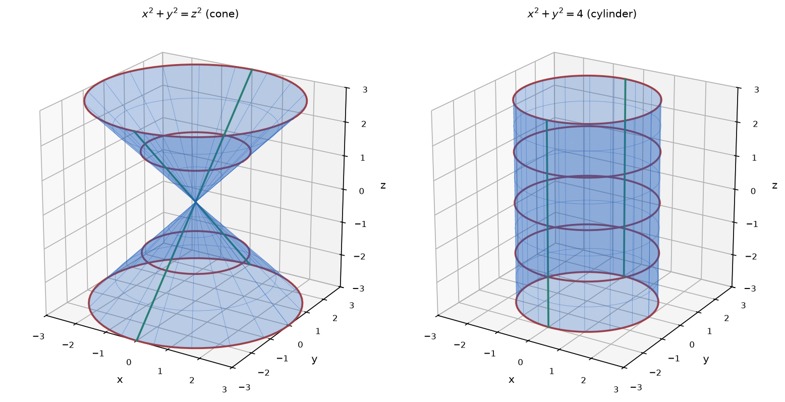

# Problem 14. Cone and Cylinder

## Exercise

### Exercise 14. Cone and Cylinder
Compare

$$
x^2+y^2=z^2
$$

and

$$
x^2+y^2=4.
$$

For each surface, describe the cross-sections $z=c$, $x=0$, and $y=0$, make a sketch, and explain why the radius of the cross-section depends on $z$ in the first case but is constant in the second.

> **Why this exercise:** teaches how to distinguish a cone from a cylinder by the behavior of their cross-sections.

---

## Answer

| Cross-section | Cone $x^2+y^2=z^2$ | Cylinder $x^2+y^2=4$ |
|---|---|---|
| $z=c$ | circle of radius $\lvert c\rvert$, a single point for $c=0$ | circle of radius $2$ for every $c$ |
| $x=0$ | two lines through the origin, $z=\pm y$ | two vertical lines, $y=\pm2$ |
| $y=0$ | two lines through the origin, $z=\pm x$ | two vertical lines, $x=\pm2$ |

In the first equation $z$ appears on the right side and sets the squared radius, so the radius changes with height. In the second equation $z$ does not appear at all, so every height gives the same circle.

---

## Sketch

The left sketch shows a double cone with its vertex at the origin. The circles grow in proportion to their distance from the vertex. The right sketch shows a cylinder around the $z$-axis. All circles are equal and the side lines are vertical.

---

## Steps

### Step 1. Cone, horizontal cross-sections

Substituting $z=c$:

$$
x^2+y^2=c^2
$$

This is a circle of radius $|c|$ centered on the $z$-axis. For $c=0$ it reduces to the single point $(0,0,0)$, the vertex.

### Step 2. Cone, vertical cross-sections

$$
x=0:\ y^2=z^2\quad\Longrightarrow\quad z=\pm y
$$

$$
y=0:\ x^2=z^2\quad\Longrightarrow\quad z=\pm x
$$

Each section is a pair of straight lines crossing at the origin at $45^\circ$ to the $z$-axis.

### Step 3. Cylinder, horizontal cross-sections

The equation $x^2+y^2=4$ does not contain $z$. Substituting $z=c$ changes nothing:

$$
x^2+y^2=4
$$

The section is a circle of radius $2$ for every value of $c$.

### Step 4. Cylinder, vertical cross-sections

$$
x=0:\ y^2=4\quad\Longrightarrow\quad y=\pm2
$$

$$
y=0:\ x^2=4\quad\Longrightarrow\quad x=\pm2
$$

In the plane $x=0$ the conditions $y=2$ and $y=-2$ leave $z$ free. Each is a vertical line parallel to the $z$-axis. The same holds in the plane $y=0$.

### Step 5. Compare the radii

| Height $c$ | $0$ | $\pm1$ | $\pm2$ | $\pm3$ |
|---|---|---|---|---|
| Cone, radius | $0$ | $1$ | $2$ | $3$ |
| Cylinder, radius | $2$ | $2$ | $2$ | $2$ |

The two surfaces have the same section only at the heights $c=\pm2$.

---

## Why it works

**The role of $z$ in each equation.** In both equations the left side $x^2+y^2$ is the squared distance from the $z$-axis.

- Cone: the equation states that the distance from the axis equals $|z|$. The height controls the radius.
- Cylinder: the equation states that the distance from the axis equals $2$. The height is not mentioned, so it is unrestricted.

**A missing variable means a free direction.** When an equation in space does not contain $z$, a point $(x,y,z)$ satisfies it or not regardless of $z$. If one point belongs to the surface, the whole vertical line through it belongs to the surface. The surface is the circle $x^2+y^2=4$ of the $xy$-plane moved along the $z$-axis. This holds for any equation with a missing variable and is the general way to recognize a cylinder.

**Why the cone has straight sides.** The radius of the cone grows in proportion to the height: $r=|c|$. A radius proportional to the height gives straight lines in a vertical section. For comparison, the paraboloid $z=x^2+y^2$ has $r=\sqrt{c}$ and curved sides.

**The cone consists of lines through the vertex.** If $(x,y,z)$ satisfies $x^2+y^2=z^2$, then so does $(tx,ty,tz)$ for every $t$, because both sides are multiplied by $t^2$. Each point of the cone therefore lies on a line through the origin contained in the cone. In the cylinder the lines are parallel instead of passing through one point.

---

## Check

Points of the cone:

$$
(3,4,5):\ 9+16=25\ \checkmark,\qquad (3,4,-5):\ 9+16=25\ \checkmark
$$

The multiple $(6,8,10)$ of the first point is also on the cone:

$$
36+64=100\ \checkmark
$$

Points of the cylinder at different heights:

$$
(2,0,0):\ 4+0=4\ \checkmark,\qquad (2,0,7):\ 4+0=4\ \checkmark,\qquad \left(\sqrt2,\sqrt2,-3\right):\ 2+2=4\ \checkmark
$$

The two surfaces meet where both equations hold. Then $z^2=4$, so $z=\pm2$, and the common points form the two circles $x^2+y^2=4$ at the heights $z=2$ and $z=-2$. This agrees with the table in Step 5 ✓.
