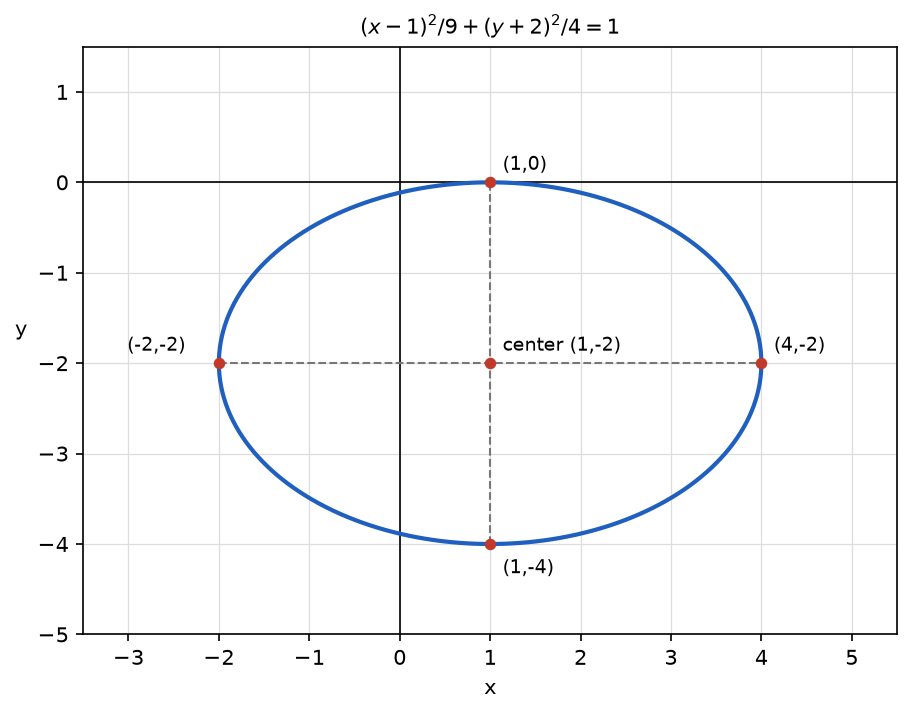
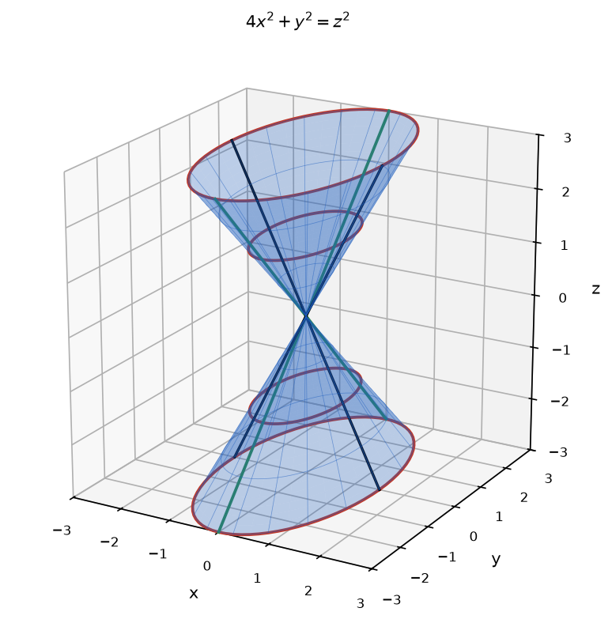

# Problem 15. Recognition and Sketch Without a Given Name

## Exercise

### Exercise 15. Recognition and Sketch Without a Given Name
Consider the two equations:

$$
4x^2+9y^2-8x+36y+4=0,
$$

$$
4x^2+y^2=z^2.
$$

For the first equation, reduce it to canonical form, recognize the curve, give its most important features, and make a sketch.

For the second equation, do not begin by using a ready-made name for the surface. First describe the cross-sections $z=c$ and the cross-sections by the planes $x=0$ and $y=0$, paying attention to the different scales along the axes. Only then identify the surface and make a sketch.

> **Why this exercise:** tests transfer of the two main mechanisms of the set—moving to canonical form and recognizing an object through cross-sections—without allowing the easiest example to be chosen.

---

## Answer

**First equation.** The canonical form is

$$
\frac{(x-1)^2}{9}+\frac{(y+2)^2}{4}=1
$$

The curve is an ellipse with center $(1,-2)$, semiaxis $3$ in the $x$-direction, and semiaxis $2$ in the $y$-direction. The ends of its axes are $(4,-2)$, $(-2,-2)$, $(1,0)$, and $(1,-4)$.

**Second equation.**

| Cross-section | Result |
|---|---|
| $z=c$, $c\neq0$ | ellipse with semiaxis $\frac{\lvert c\rvert}{2}$ along $x$ and semiaxis $\lvert c\rvert$ along $y$ |
| $z=0$ | the single point $(0,0,0)$ |
| $x=0$ | two lines $z=\pm y$ |
| $y=0$ | two lines $z=\pm2x$ |

The surface is an elliptic cone with its vertex at the origin and the $z$-axis as its axis. It is twice as wide in the $y$-direction as in the $x$-direction.

---

## Sketch

The ellipse is centered at $(1,-2)$. It is $6$ units wide and $4$ units high, and it touches the $x$-axis at the point $(1,0)$.

The cone has two parts meeting at the origin. The horizontal sections are ellipses elongated along $y$. The side lines in the plane $x=0$ are less steep than the side lines in the plane $y=0$.

---

## Steps

### Step 1. First equation: group and factor

$$
4(x^2-2x)+9(y^2+4y)=-4
$$

### Step 2. Complete the squares

$$
x^2-2x=(x-1)^2-1,\qquad y^2+4y=(y+2)^2-4
$$

$$
\begin{aligned}
4\left((x-1)^2-1\right)+9\left((y+2)^2-4\right) &= -4 \\
4(x-1)^2-4+9(y+2)^2-36 &= -4 \\
4(x-1)^2+9(y+2)^2 &= 36
\end{aligned}
$$

### Step 3. Canonical form

Dividing by $36$:

$$
\frac{(x-1)^2}{9}+\frac{(y+2)^2}{4}=1
$$

### Step 4. Recognize the curve and read its features

Both squares have positive coefficients, the denominators are different, and the right side is positive. The curve is an ellipse.

- Center: $(1,-2)$.
- Semiaxes: $a=3$ horizontally and $b=2$ vertically.
- Ends of the horizontal axis: $(1\pm3,\ -2)$, which are $(4,-2)$ and $(-2,-2)$.
- Ends of the vertical axis: $(1,\ -2\pm2)$, which are $(1,0)$ and $(1,-4)$.
- The longer axis is horizontal.

### Step 5. Second equation: horizontal cross-sections

Substituting $z=c$:

$$
4x^2+y^2=c^2
$$

For $c\neq0$, dividing by $c^2$:

$$
\frac{x^2}{(c/2)^2}+\frac{y^2}{c^2}=1
$$

This is an ellipse with semiaxis $\frac{|c|}{2}$ along $x$ and semiaxis $|c|$ along $y$. For $c=0$ the equation $4x^2+y^2=0$ gives only $x=y=0$, a single point.

| $c$ | $0$ | $\pm1$ | $\pm2$ | $\pm4$ |
|---|---|---|---|---|
| semiaxis along $x$ | $0$ | $\frac12$ | $1$ | $2$ |
| semiaxis along $y$ | $0$ | $1$ | $2$ | $4$ |

Both semiaxes grow in proportion to $|c|$, and the ratio $1:2$ is the same at every height.

### Step 6. Second equation: cross-section $x=0$

$$
y^2=z^2\quad\Longrightarrow\quad z=\pm y
$$

Two lines through the origin with slopes $\pm1$ in the $yz$-plane.

### Step 7. Second equation: cross-section $y=0$

$$
4x^2=z^2\quad\Longrightarrow\quad z=\pm2x
$$

Two lines through the origin with slopes $\pm2$ in the $xz$-plane. These lines are steeper than those in Step 6.

### Step 8. Identify the surface

- The horizontal sections shrink to a point at $z=0$ and grow in proportion to the distance from it.
- The vertical sections through the axis are pairs of straight lines through that point.
- The horizontal sections are ellipses, not circles.

A surface made of straight lines through one point, with elliptic sections, is an elliptic cone. Its vertex is the origin and its axis is the $z$-axis.

---

## Why it works

**First equation: the same mechanism as for a circle.** Completing the square removes the linear terms and reveals a shift. In the coordinates $u=x-1$, $v=y+2$ the equation is $\frac{u^2}{9}+\frac{v^2}{4}=1$, a standard ellipse. The curve is this ellipse moved by $1$ to the right and by $2$ down.

**Second equation: the different scales.** The coefficient $4$ in front of $x^2$ compresses the surface in the $x$-direction. At height $c$ the surface reaches $|c|$ along $y$ but only $\frac{|c|}{2}$ along $x$. The same fact appears in the vertical sections: to reach height $z$, a point must move $|z|$ away from the axis along $y$ but only $\frac{|z|}{2}$ along $x$, so the lines in the $xz$-plane are steeper.

**Why the surface is a cone and not another surface.** Every term of $4x^2+y^2=z^2$ has degree $2$ and there is no constant term. If $(x,y,z)$ satisfies the equation, then $(tx,ty,tz)$ satisfies it for every $t$, since both sides are multiplied by $t^2$. The surface therefore consists of whole lines through the origin. This property defines a cone.

**Comparison with the circular cone.** The substitution $u=2x$ turns the equation into $u^2+y^2=z^2$, the circular cone of Exercise 14. The surface is that cone compressed by the factor $2$ in the $x$-direction. Compression turns circles into ellipses and keeps straight lines straight.

---

## Check

**First equation.** The four ends of the axes satisfy the original equation:

$$
(4,-2):\ 64+36-32-72+4=0\ \checkmark
$$

$$
(-2,-2):\ 16+36+16-72+4=0\ \checkmark
$$

$$
(1,0):\ 4+0-8+0+4=0\ \checkmark
$$

$$
(1,-4):\ 4+144-8-144+4=0\ \checkmark
$$

Substituting the center gives the negative of the right side of Step 2:

$$
(1,-2):\ 4+36-8-72+4=-36\ \checkmark
$$

The ellipse touches the $x$-axis. Setting $y=0$ in the original equation gives

$$
4x^2-8x+4=0\quad\Longrightarrow\quad 4(x-1)^2=0\quad\Longrightarrow\quad x=1
$$

There is one double solution, so the $x$-axis is tangent to the ellipse at $(1,0)$. This agrees with the top point found in Step 4 ✓.

**Second equation.** Points taken from the cross-sections satisfy the equation.

From the ellipse at height $c=2$, the ends of its axes $(1,0,2)$ and $(0,2,2)$:

$$
4\cdot1+0=4=2^2\ \checkmark,\qquad 0+4=4=2^2\ \checkmark
$$

A point of the same ellipse off the axes, $\left(\frac{\sqrt2}{2},\sqrt2,2\right)$:

$$
4\cdot\frac12+2=4=2^2\ \checkmark
$$

Scaling this point by $3$ gives $\left(\frac{3\sqrt2}{2},3\sqrt2,6\right)$, which is also on the surface:

$$
4\cdot\frac{9}{2}+18=36=6^2\ \checkmark
$$
