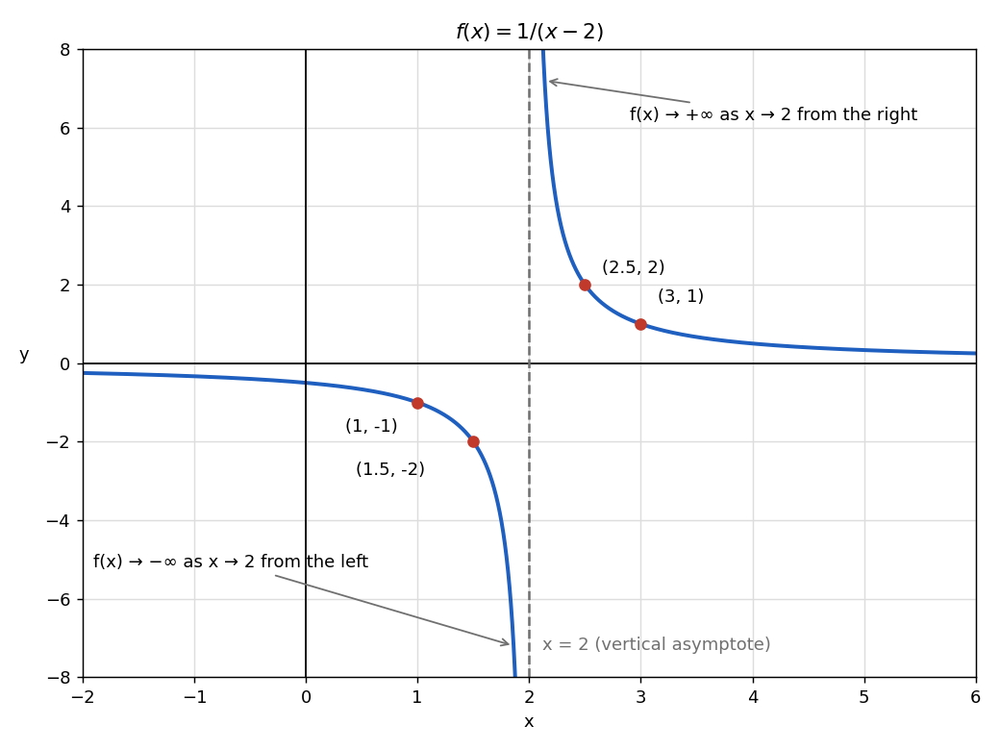

# Problem 9. One-Sided Limits and an Asymptote

## Exercise

### Exercise 9. One-Sided Limits and an Asymptote
Analyze the left-hand and right-hand limits of

$$
f(x)=\frac1{x-2}
$$

as $x\to2$. Does the two-sided limit exist? Interpret the result on a sketch of the graph and identify the vertical asymptote.

> **Why this exercise:** teaches how to distinguish one-sided limits and connect them with the geometry of an asymptote.

---

## Answer

$$
\lim_{x\to2^-}\frac1{x-2}=-\infty,\qquad \lim_{x\to2^+}\frac1{x-2}=+\infty
$$

- The two-sided limit does not exist, because the one-sided limits are different.
- The vertical asymptote is the line $x=2$.
- On the graph the left branch runs downward along the asymptote and the right branch runs upward along it.

---

## Sketch

The graph has two separate branches. To the left of the line $x=2$ the function is negative and the curve falls without bound as it approaches the line. To the right of the line the function is positive and the curve rises without bound. The curve never meets the line $x=2$.

---

## Steps

### Step 1. Left-hand limit

For $x\lt2$ the denominator $x-2$ is negative. As $x$ approaches $2$ it becomes a small negative number, and the quotient becomes a large negative number.

| $x$ | $1.9$ | $1.99$ | $1.999$ |
|---|---|---|---|
| $x-2$ | $-0.1$ | $-0.01$ | $-0.001$ |
| $f(x)$ | $-10$ | $-100$ | $-1000$ |

$$
\lim_{x\to2^-}\frac1{x-2}=-\infty
$$

### Step 2. Right-hand limit

For $x\gt2$ the denominator is positive. As $x$ approaches $2$ it becomes a small positive number, and the quotient becomes a large positive number.

| $x$ | $2.1$ | $2.01$ | $2.001$ |
|---|---|---|---|
| $x-2$ | $0.1$ | $0.01$ | $0.001$ |
| $f(x)$ | $10$ | $100$ | $1000$ |

$$
\lim_{x\to2^+}\frac1{x-2}=+\infty
$$

### Step 3. Two-sided limit

A two-sided limit exists only when both one-sided limits exist and are equal. Here one is $-\infty$ and the other is $+\infty$. The two-sided limit does not exist, neither as a number nor as an infinite limit. It is not correct to write that the limit equals $\infty$.

### Step 4. Vertical asymptote

The line $x=a$ is a vertical asymptote of a function when at least one of the one-sided limits at $a$ is $+\infty$ or $-\infty$. Both one-sided limits at $2$ are infinite, so the line $x=2$ is a vertical asymptote.

### Step 5. Points for the sketch

| $x$ | $0$ | $1$ | $1.5$ | $2.5$ | $3$ | $4$ |
|---|---|---|---|---|---|---|
| $f(x)$ | $-\frac12$ | $-1$ | $-2$ | $2$ | $1$ | $\frac12$ |

Far from $x=2$ the values are close to $0$, since $\frac1{x-2}\to0$ as $x\to\pm\infty$. The line $y=0$ is a horizontal asymptote.

---

## Why it works

**The sign of the denominator decides the direction.** The numerator is the constant $1$. Dividing $1$ by a small number gives a large number with the same sign. The denominator $x-2$ changes sign at $x=2$, so the function goes to $-\infty$ on one side and to $+\infty$ on the other.

**Precise meaning of the infinite limits.** The statement $\lim_{x\to2^+}f(x)=+\infty$ means that for every bound $M\gt0$ the inequality $f(x)\gt M$ holds for all $x$ in some interval to the right of $2$. Here

$$
2\lt x\lt2+\frac1M\quad\Longrightarrow\quad0\lt x-2\lt\frac1M\quad\Longrightarrow\quad\frac1{x-2}\gt M
$$

On the left the same argument gives $f(x)\lt-M$ for $2-\frac1M\lt x\lt2$.

**An asymptote does not need a two-sided limit.** The asymptote describes the geometry: the graph comes arbitrarily close to the vertical line while running off to infinity. This happens on each side separately. For comparison, the function $\frac1{(x-2)^2}$ is positive on both sides, both one-sided limits equal $+\infty$, and the two-sided limit is $+\infty$. Both functions have the same vertical asymptote $x=2$. They differ in the direction of the left branch.

**Connection with the graph of $\frac1x$.** The graph of $f$ is the graph of $y=\frac1x$ shifted $2$ units to the right. The asymptote $x=0$ of $\frac1x$ moves to $x=2$.

---

## Check

**Symmetry of the two branches.** For $h\gt0$,

$$
f(2-h)=-\frac1h,\qquad f(2+h)=\frac1h
$$

The values at equal distances from $2$ are opposite numbers. The tables in Steps 1 and 2 show this: $-10$ and $10$, $-100$ and $100$, $-1000$ and $1000$ ✓.

**The bound from the definition.** For $M=1000$ the interval is $2\lt x\lt2.001$. The point $x=2.0005$ lies in it and gives

$$
f(2.0005)=\frac{1}{0.0005}=2000\gt1000\ \checkmark
$$

**The function has no value at $x=2$.** The denominator equals $0$ there, so the graph has no point on the line $x=2$ ✓.
