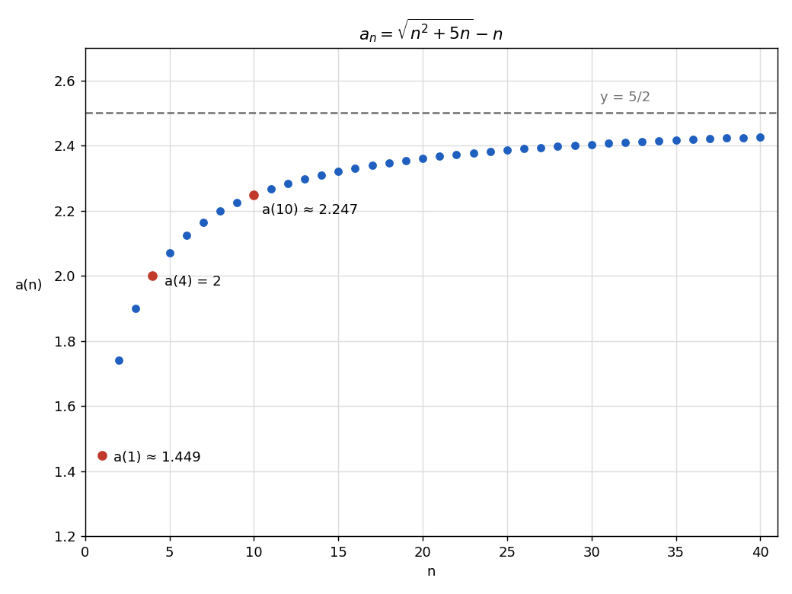
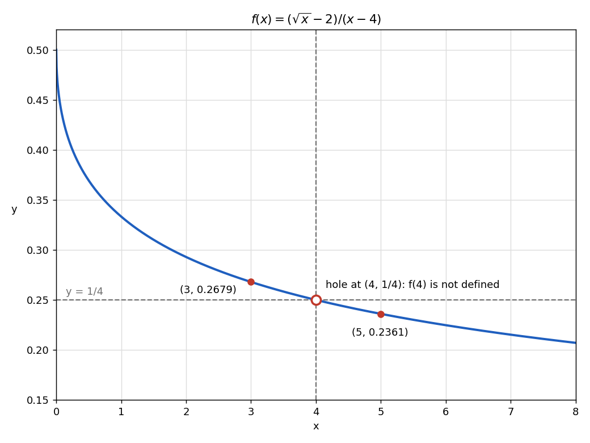

# Problem 15. Observation Versus Proof

## Exercise

### Exercise 15. Observation Versus Proof
Choose one sequence and one function from this set. For the sequence, compute several values for increasingly large $n$. For the function, prepare a table of values with arguments approaching the limit point from the left and right. Sketch the behavior of both objects.

Compare the observation with the analytical result and explain why a finite number of calculations or a sketch does not constitute a proof that the limit exists.

> **Why this exercise:** teaches how to distinguish intuition and observation from mathematical argument.

---

## Answer

**Chosen objects.**

- Sequence from Exercise 3: $a_n=\sqrt{n^2+5n}-n$.
- Function from Exercise 8: $f(x)=\frac{\sqrt x-2}{x-4}$, with limit point $x=4$.

**Comparison.**

| Object | Observation | Analytical result |
|---|---|---|
| $a_n$ | values increase and stay just below $2.5$ | $\lim_{n\to\infty}a_n=\frac52$ |
| $f(x)$ | values on both sides of $4$ approach $0.25$ | $\lim_{x\to4}f(x)=\frac14$ |

The observations agree with the analytical results. They do not prove them: a table and a sketch contain finitely many points, and a limit is a statement about infinitely many. The analytical argument covers all of them at once.

---

## Sketch

The points rise quickly at first and then flatten out below the dashed level $y=\frac52$.

The curve decreases smoothly and passes through the level $y=\frac14$ at $x=4$, where the function itself has no value. The missing point is marked by an open circle.

---

## Steps

### Step 1. Values of the sequence

| $n$ | $1$ | $10$ | $100$ | $1000$ | $10\ 000$ | $100\ 000$ |
|---|---|---|---|---|---|---|
| $a_n$ | $1.44949$ | $2.24745$ | $2.46951$ | $2.49688$ | $2.49969$ | $2.49997$ |
| $\frac52-a_n$ | $1.05051$ | $0.25255$ | $0.03049$ | $0.00312$ | $0.00031$ | $0.00003$ |

### Step 2. Observation for the sequence

- The values increase.
- The distance from $2.5$ falls about $10$ times when $n$ grows $10$ times.
- No computed value exceeds $2.5$.

The observation suggests the limit $\frac52$.

### Step 3. Values of the function

From the left:

| $x$ | $3$ | $3.9$ | $3.99$ | $3.999$ |
|---|---|---|---|---|
| $f(x)$ | $0.26795$ | $0.25158$ | $0.25016$ | $0.250016$ |

From the right:

| $x$ | $5$ | $4.1$ | $4.01$ | $4.001$ |
|---|---|---|---|---|
| $f(x)$ | $0.23607$ | $0.24846$ | $0.24984$ | $0.249984$ |

### Step 4. Observation for the function

- From the left the values decrease toward $0.25$.
- From the right the values increase toward $0.25$.
- The function is not defined at $x=4$, where the expression has the form $\frac00$.

The observation suggests the limit $\frac14$.

### Step 5. Analytical results

From Exercise 3, for every $n$:

$$
a_n=\frac{5n}{\sqrt{n^2+5n}+n}=\frac{5}{\sqrt{1+\frac5n}+1}\to\frac52
$$

From Exercise 8, for every $x\ge0$ with $x\neq4$:

$$
f(x)=\frac{1}{\sqrt x+2}\to\frac14
$$

### Step 6. Comparison

The suggested values $2.5$ and $0.25$ coincide with the proved limits $\frac52$ and $\frac14$. The observation is consistent with the analysis in every detail: the direction of approach, the absence of values above $2.5$, and the rate at which the distances shrink.

---

## Why it works

### Why a finite number of calculations is not a proof

**Finitely many against infinitely many.** The definition of a limit requires that for every $\varepsilon\gt0$ all terms beyond some index lie within $\varepsilon$ of the limit. A table checks a few terms for a few values of $\varepsilon$. The terms that were not computed are infinitely many, and the table carries no information about them.

**A sequence with the same table and no limit.** Let

$$
b_n=a_n+\frac{n}{10^{9}}
$$

For $n\le1000$ the added term is at most $10^{-6}$, so the first four columns of the table in Step 1 are unchanged to five decimal places. But $b_n$ grows without bound: for $n=10^9$ the added term alone equals $1$, and for $n=10^{12}$ it equals $1000$. A reader of the short table cannot tell $a_n$ from $b_n$.

**A function with a misleading table.** Let $g(x)=\sin\frac\pi x$ and consider $x\to0$.

| $x$ | $\pm0.1$ | $\pm0.01$ | $\pm0.001$ |
|---|---|---|---|
| $\frac\pi x$ | $\pm10\pi$ | $\pm100\pi$ | $\pm1000\pi$ |
| $g(x)$ | $0$ | $0$ | $0$ |

The table suggests the limit $0$ from both sides. A different choice of arguments gives a different picture:

| $x$ | $\frac25$ | $\frac29$ | $\frac2{13}$ |
|---|---|---|---|
| $\frac\pi x$ | $\frac{5\pi}{2}$ | $\frac{9\pi}{2}$ | $\frac{13\pi}{2}$ |
| $g(x)$ | $1$ | $1$ | $1$ |

The function takes the values $0$ and $1$ arbitrarily close to $0$, so the limit does not exist. A table shows the function only at the chosen arguments, and the choice can hide the true behavior.

**The value of the limit is not identified.** The value $2.49997$ at $n=100\ 000$ is consistent with a limit of $2.5$ and also with a limit of $2.49999$ or $2.50001$. Finitely many digits cannot select one real number.

### Why a sketch is not a proof

- A sketch is drawn from finitely many computed points, joined by eye or by a program. It contains no more information than the table behind it.
- A sketch has finite resolution. Two curves that differ by less than the width of the line look the same. The open circle at $x=4$ is put there by the person who draws the graph and knows about it in advance. The plotted curve alone does not reveal a single missing point.
- A sketch shows a finite window. The sketch of the sequence stops at $n=40$, where the values are near $2.43$. Nothing in the picture excludes a slow further growth beyond $2.5$.

### What the analytical argument adds

The algebraic identities in Step 5 hold for every $n$ and every admissible $x$, not for selected ones. They lead to explicit bounds on the distance from the limit.

For the sequence, with $s=\sqrt{1+\frac5n}\gt1$:

$$
\frac52-a_n=\frac52-\frac{5}{s+1}=\frac{5(s-1)}{2(s+1)}=\frac{25}{2n(s+1)^2}\lt\frac{25}{8n}
$$

where the third equality uses $s-1=\frac{s^2-1}{s+1}=\frac{5}{n(s+1)}$. For any $\varepsilon\gt0$ every $n\gt\frac{25}{8\varepsilon}$ gives $0\lt\frac52-a_n\lt\varepsilon$. This is the definition of the limit, verified for all $\varepsilon$ and all large $n$.

For the function:

$$
f(x)-\frac14=\frac{1}{\sqrt x+2}-\frac14=\frac{2-\sqrt x}{4\left(\sqrt x+2\right)}=\frac{4-x}{4\left(\sqrt x+2\right)^2}
$$

Since $\left(\sqrt x+2\right)^2\ge4$,

$$
\left|f(x)-\frac14\right|\le\frac{|x-4|}{16}
$$

For any $\varepsilon\gt0$ the choice $\delta=16\varepsilon$ satisfies the definition of the limit.

Observation proposes the value of a limit and helps to detect errors. The proof establishes that the limit exists and equals that value.

---

## Check

**The bound for the sequence against the table.**

| $n$ | $1$ | $100$ | $1000$ |
|---|---|---|---|
| $\frac52-a_n$ | $1.05051$ | $0.03049$ | $0.00312$ |
| Bound $\frac{25}{8n}$ | $3.125$ | $0.03125$ | $0.003125$ |

Every computed distance is positive and below the bound ✓.

**The bound for the function against the table.**

| $x$ | $3.9$ | $4.1$ | $3.99$ |
|---|---|---|---|
| $\left\lvert f(x)-\frac14\right\rvert$ | $0.00158$ | $0.00154$ | $0.00016$ |
| Bound $\frac{\lvert x-4\rvert}{16}$ | $0.00625$ | $0.00625$ | $0.000625$ |

Every computed distance is below the bound ✓.

**Direction of approach.** The formula $f(x)-\frac14=\frac{4-x}{4\left(\sqrt x+2\right)^2}$ is positive for $x\lt4$ and negative for $x\gt4$. The table in Step 3 shows values above $0.25$ on the left and below $0.25$ on the right ✓.

**The counterexample values.**

$$
\sin10\pi=0,\qquad \sin\frac{5\pi}{2}=\sin\left(2\pi+\frac\pi2\right)=1\ \checkmark
$$
