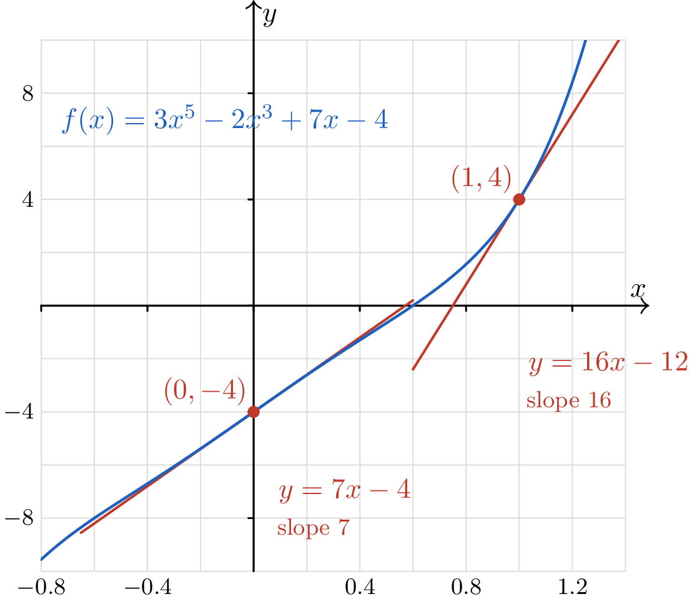

# Problem 1. Derivative of a Polynomial and the Slope of a Tangent Line

## Exercise

### Problem 1. Derivative of a Polynomial and the Slope of a Tangent Line
For

$$
f(x)=3x^5-2x^3+7x-4
$$

find $f'(x)$. Then compute $f'(0)$ and $f'(1)$, determine the signs of the obtained values, and explain what they say about the slope of the tangent line to the graph at these two points.

> **Why this problem:** it reinforces the power rule and connects the value of the derivative at a point with the geometric meaning of the tangent slope.

---

## Answer

$$
f'(x)=15x^4-6x^2+7
$$

$$
f'(0)=7\gt0,\qquad f'(1)=16\gt0
$$

Both values are positive, so at both points the tangent line rises from left to right and the function is increasing there. At $x=1$ the tangent is steeper than at $x=0$, because $16\gt7$.

| Point | $f(x_0)$ | $f'(x_0)$ | Sign | Tangent line |
|---|---|---|---|---|
| $x_0=0$ | $-4$ | $7$ | $+$ | $y=7x-4$, rises |
| $x_0=1$ | $4$ | $16$ | $+$ | $y=16x-12$, rises more steeply |

---

## Sketch

The blue curve is $f(x)=3x^5-2x^3+7x-4$. The red lines are the tangents at the points $(0,-4)$ and $(1,4)$, with slopes $7$ and $16$. Both lines rise, and the one at $x=1$ is steeper. Near $(0,-4)$ the curve stays close to its tangent over a long stretch and crosses it there, because $x=0$ is an inflection point: $f''(x)=60x^3-12x$ changes sign at $0$. The vertical unit is smaller than the horizontal one, so all slopes look flatter than they are.

---

## Steps

### Step 1. Differentiate term by term

The derivative of a sum is the sum of the derivatives, and a constant factor stays in front. Each term is a constant times a power of $x$, so the power rule $\left(x^n\right)'=nx^{n-1}$ applies to every term:

| Term | Rule | Derivative |
|---|---|---|
| $3x^5$ | $3\cdot5x^4$ | $15x^4$ |
| $-2x^3$ | $-2\cdot3x^2$ | $-6x^2$ |
| $7x$ | $7\cdot1$ | $7$ |
| $-4$ | constant | $0$ |

$$
f'(x)=15x^4-6x^2+7
$$

### Step 2. Value at $x=0$

$$
f'(0)=15\cdot0-6\cdot0+7=7
$$

### Step 3. Value at $x=1$

$$
f'(1)=15-6+7=16
$$

### Step 4. Signs and interpretation

Both numbers are positive.

- The slope of the tangent at $(0,-4)$ is $7$: one unit to the right along the tangent means $7$ units up.
- The slope of the tangent at $(1,4)$ is $16$: one unit to the right along the tangent means $16$ units up.

A positive slope means that the tangent line rises from left to right, so near each of the two points the values of $f$ increase with $x$. The larger value $f'(1)=16$ means that near $x=1$ the function grows more than twice as fast as near $x=0$.

### Step 5. The tangent lines

With $f(0)=-4$ and $f(1)=3-2+7-4=4$, the point-slope form $y=f(x_0)+f'(x_0)(x-x_0)$ gives

$$
x_0=0:\ \ y=-4+7x,\qquad x_0=1:\ \ y=4+16(x-1)=16x-12
$$

---

## Why it works

**Why the power rule is the right tool.** The function is a sum of constant multiples of powers of $x$. The derivative is linear, which means

$$
\left(af+bg\right)'=af'+bg'
$$

so the polynomial can be differentiated one term at a time, and each term needs only the power rule. No product, quotient, or chain rule is involved.

**The derivative at a point is a slope.** By definition

$$
f'(x_0)=\lim_{h\to0}\frac{f(x_0+h)-f(x_0)}h
$$

The fraction is the slope of the secant line through $(x_0,f(x_0))$ and $(x_0+h,f(x_0+h))$. As $h\to0$ the secants turn into the tangent line, and their slopes approach $f'(x_0)$. The number $f'(x_0)$ is therefore the slope of the tangent line at $x_0$.

**What the sign says.**

| Sign of $f'(x_0)$ | Tangent line | Function near $x_0$ |
|---|---|---|
| $+$ | rises from left to right | increasing |
| $0$ | horizontal | neither, at this level of detail |
| $-$ | falls from left to right | decreasing |

**A remark on the whole real line.** With $t=x^2\ge0$ the derivative is $15t^2-6t+7$. Its discriminant is $36-4\cdot15\cdot7=-384\lt0$, so it has no real zeros and is positive for every $x$. The tangent rises at every point of the graph, not only at $x=0$ and $x=1$, and $f$ is increasing on the whole real line.

---

## Check

**Difference quotients near the two points.**

| $h$ | $\frac{f(h)-f(0)}h$ | $\frac{f(1+h)-f(1)}h$ |
|---|---|---|
| $0.1$ | $6.9803$ | $18.6953$ |
| $0.01$ | $6.9998$ | $16.2428$ |
| $0.001$ | $7.0000$ | $16.0240$ |

The quotients approach $7$ and $16$ ✓.

**The tangent lines pass through the points of tangency.**

$$
7\cdot0-4=-4=f(0),\qquad 16\cdot1-12=4=f(1)\ \checkmark
$$
