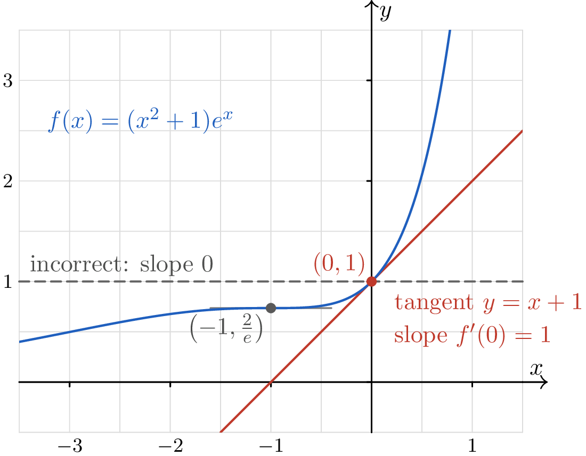

# Problem 3. The Product Rule — Why Is It Needed?

## Exercise

### Problem 3. The Product Rule — Why Is It Needed?
For

$$
f(x)=(x^2+1)e^x
$$

compute the derivative. Then compare the correct result with the incorrect idea

$$
f'(x)\stackrel{?}{=}(2x)e^x
$$

and explain which term is missing.

> **Why this problem:** it teaches the product rule by analyzing a common mistake.

---

## Answer

$$
f'(x)=2x\ e^x+(x^2+1)e^x=(x+1)^2e^x
$$

The incorrect formula $(2x)e^x$ keeps only the term in which the first factor is differentiated. The missing term is

$$
(x^2+1)e^x
$$

in which the first factor is left unchanged and the second factor $e^x$ is differentiated. The two formulas differ by exactly this term, which is positive for every $x$, so the incorrect formula always gives too small a slope.

---

## Sketch

The blue curve is $f(x)=(x^2+1)e^x$. At the point $(0,1)$ the red tangent line has slope $f'(0)=1$ and follows the curve. The dashed gray line has slope $0$, the value of the incorrect formula $(2x)e^x$ at $x=0$, and it visibly does not touch the curve in the tangent direction. The curve also has a horizontal tangent at $\left(-1,\frac2e\right)$, where the correct derivative $(x+1)^2e^x$ vanishes.

---

## Steps

### Step 1. Identify the structure

The function is a product of two factors:

$$
u(x)=x^2+1,\qquad v(x)=e^x
$$

with derivatives

$$
u'(x)=2x,\qquad v'(x)=e^x
$$

### Step 2. Apply the product rule

$$
(uv)'=u'v+uv'
$$

$$
f'(x)=2x\cdot e^x+(x^2+1)\cdot e^x
$$

### Step 3. Simplify

Factor out $e^x$ and recognize a perfect square:

$$
f'(x)=e^x\left(x^2+2x+1\right)=(x+1)^2e^x
$$

### Step 4. Compare with the incorrect formula

$$
f'(x)-(2x)e^x=(x^2+1)e^x
$$

The incorrect formula is the product of the derivatives, $u'v'=2x\cdot e^x$. Since $\left(e^x\right)'=e^x$, this product coincides with $u'v$, the first term of the product rule: $x^2+1$ is differentiated and $e^x$ is copied. The second term $uv^{\prime}$, in which $e^x$ is differentiated and $x^2+1$ is copied, is missing.

| $x$ | correct $(x+1)^2e^x$ | incorrect $2x\ e^x$ | missing term $(x^2+1)e^x$ |
|---|---|---|---|
| $-1$ | $0$ | $-0.7358$ | $0.7358$ |
| $0$ | $1$ | $0$ | $1$ |
| $1$ | $10.8731$ | $5.4366$ | $5.4366$ |

At $x=0$ the incorrect formula predicts a horizontal tangent, although the graph rises there with slope $1$. For $x\lt0$ it predicts a negative slope, although the correct derivative $(x+1)^2e^x$ is never negative and $f$ is increasing on the whole real line.

---

## Why it works

**Where the two terms come from.** A product changes when either factor changes. For a small step $h$,

$$
u(x+h)v(x+h)-u(x)v(x)=\left[u(x+h)-u(x)\right]v(x+h)+u(x)\left[v(x+h)-v(x)\right]
$$

Dividing by $h$ and letting $h\to0$ gives $u'v+uv^{\prime}$: the first bracket records the change caused by $u$, the second the change caused by $v$. The incorrect formula records only the change caused by $u$, as if $v=e^x$ were a constant.

**A rectangle picture.** If $u$ and $v$ are the sides of a rectangle, the area $uv$ grows by a strip of size $\Delta u\cdot v$ along one side and a strip of size $u\cdot\Delta v$ along the other. Both strips contribute. The corner piece $\Delta u\ \Delta v$ is of second order and disappears in the limit.

**Why the product rule is needed here.** The derivative of a sum is the sum of derivatives, but the derivative of a product is not the product of derivatives. Neither $u'v$ alone nor $u'v^{\prime}$ is correct. The full product rule $u'v+uv^{\prime}$ is the only formula that accounts for both factors changing at once.

**The sign of the result.** Since $(x+1)^2\ge0$ and $e^x\gt0$, the derivative is non-negative and vanishes only at $x=-1$. The function is increasing on the whole real line, with a horizontal tangent at $x=-1$ that is not an extremum.

---

## Check

**Difference quotients.**

| $x_0$ | $h$ | $\frac{f(x_0+h)-f(x_0)}h$ | $f'(x_0)$ |
|---|---|---|---|
| $0$ | $0.001$ | $1.0015$ | $1$ |
| $1$ | $0.001$ | $10.8840$ | $10.8731$ |

The quotients agree with the correct formula, not with the incorrect one, which gives $0$ and $5.4366$ ✓.

**Expansion of the simplified form.**

$$
(x+1)^2e^x=(x^2+2x+1)e^x=2x\ e^x+(x^2+1)e^x\ \checkmark
$$
