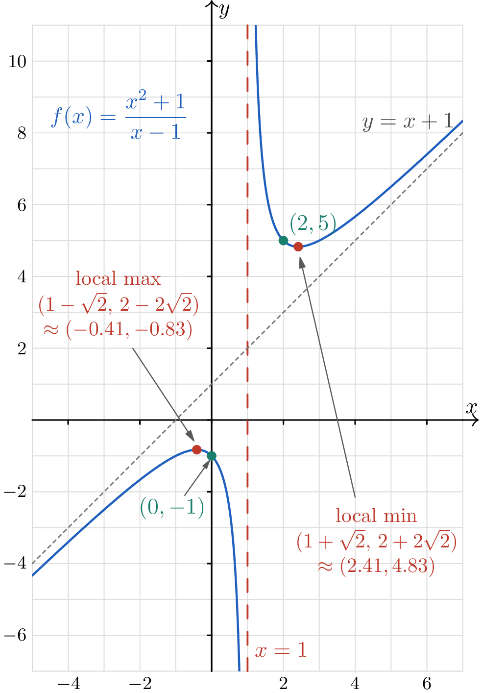

# Problem 4. A Quotient and Domain Control

## Exercise

### Problem 4. A Quotient and Domain Control
For

$$
f(x)=\frac{x^2+1}{x-1}
$$

determine the domain, compute the derivative, simplify the result, and explain why the restriction $x\neq1$ remains important.

> **Why this problem:** it practices the quotient rule together with domain control.

---

## Answer

Domain: all real $x$ with $x\neq1$.

$$
f'(x)=\frac{x^2-2x-1}{(x-1)^2},\qquad x\neq1
$$

The restriction $x\neq1$ remains important for three reasons:

1. $f(1)$ does not exist, so $f'(1)$ cannot exist either: a derivative at a point needs the value at that point.
2. The numerator $x^2-2x-1$ equals $-2$ at $x=1$, so no factor $x-1$ cancels and the simplified formula is still undefined there. The graph has a vertical asymptote $x=1$.
3. The point $x=1$ splits the domain into two separate intervals. Conclusions drawn from the sign of $f'(x)$ are valid on each interval separately, not across $x=1$.

---

## Sketch

The vertical dashed line $x=1$ is excluded from the domain and separates two branches. The oblique dashed line is the asymptote $y=x+1$. The red points are where $f'(x)=0$: a local maximum at $\left(1-\sqrt2,\ 2-2\sqrt2\right)\approx(-0.41,-0.83)$ and a local minimum at $\left(1+\sqrt2,\ 2+2\sqrt2\right)\approx(2.41,4.83)$. Between them the derivative is negative, yet the green point $(0,-1)$ lies below the green point $(2,5)$, because the graph jumps across the asymptote.

---

## Steps

### Step 1. Domain

A fraction is defined when its denominator is not zero:

$$
x-1\neq0\quad\Longleftrightarrow\quad x\neq1
$$

$$
D(f)=(-\infty,1)\cup(1,\infty)
$$

### Step 2. Identify the structure

The function is a quotient

$$
u(x)=x^2+1,\quad v(x)=x-1,\qquad u'(x)=2x,\quad v'(x)=1
$$

### Step 3. Apply the quotient rule

$$
\left(\frac uv\right)'=\frac{u'v-uv'}{v^2}
$$

$$
f'(x)=\frac{2x(x-1)-(x^2+1)\cdot1}{(x-1)^2}
$$

### Step 4. Simplify the numerator

$$
2x(x-1)-(x^2+1)=2x^2-2x-x^2-1=x^2-2x-1
$$

$$
f'(x)=\frac{x^2-2x-1}{(x-1)^2},\qquad x\neq1
$$

### Step 5. Check for cancellation

The numerator at $x=1$ equals $1-2-1=-2\neq0$, so $x-1$ is not a factor of it and the fraction cannot be reduced. The formula keeps the denominator $(x-1)^2$ and stays undefined at $x=1$.

### Step 6. Sign of the derivative

The denominator $(x-1)^2$ is positive for $x\neq1$, so the sign of $f'(x)$ is the sign of $x^2-2x-1$. Its zeros are $x=1\pm\sqrt2$.

| Interval | $(-\infty,1-\sqrt2)$ | $(1-\sqrt2,1)$ | $(1,1+\sqrt2)$ | $(1+\sqrt2,\infty)$ |
|---|---|---|---|---|
| Sign of $f'(x)$ | $+$ | $-$ | $-$ | $+$ |
| $f$ | increasing | decreasing | decreasing | increasing |

The value $x=1$ is a boundary in the table although $f'(x)$ does not change sign there. It must appear because the function does not exist at that point.

---

## Why it works

**Why the quotient rule.** The function is a ratio of two polynomials, and the denominator depends on $x$. The quotient rule is the product rule applied to $u\cdot v^{-1}$ together with the chain rule $\left(v^{-1}\right)'=-v^{-2}v^{\prime}$:

$$
\left(uv^{-1}\right)'=u'v^{-1}-uv^{-2}v'=\frac{u'v-uv'}{v^2}
$$

The factor $v^2$ in the denominator shows that the rule itself is valid only where $v\neq0$.

**Why the restriction cannot be dropped after simplifying.** Simplifying an expression does not change the set of points where the function exists. The derivative is defined through

$$
f'(x_0)=\lim_{h\to0}\frac{f(x_0+h)-f(x_0)}h
$$

and this requires the value $f(x_0)$. At $x_0=1$ there is no value, so there is no derivative, whatever formula is obtained.

**Why the sign alone does not decide across $x=1$.** The derivative is negative on both $(1-\sqrt2,1)$ and $(1,1+\sqrt2)$, yet

$$
f(0)=-1\lt5=f(2)
$$

The statement "negative derivative implies decreasing" holds on an interval, and $(1-\sqrt2,1+\sqrt2)$ with the point $1$ removed is not an interval. Near $x=1$ the values fall to $-\infty$ from the left and come back from $+\infty$ on the right.

**Another form of the same function.** Polynomial division gives

$$
f(x)=x+1+\frac2{x-1},\qquad f'(x)=1-\frac2{(x-1)^2}
$$

The second form shows the oblique asymptote $y=x+1$ and the vertical asymptote $x=1$ directly, and it carries the same restriction $x\neq1$.

---

## Check

**The two forms of the derivative agree.**

$$
1-\frac2{(x-1)^2}=\frac{(x-1)^2-2}{(x-1)^2}=\frac{x^2-2x-1}{(x-1)^2}\ \checkmark
$$

**Difference quotients with $h=0.001$.**

| $x_0$ | $\frac{f(x_0+h)-f(x_0)}h$ | $f'(x_0)$ |
|---|---|---|
| $-1$ | $0.49975$ | $0.5$ |
| $0$ | $-1.0020$ | $-1$ |
| $3$ | $0.50025$ | $0.5$ |

✓

**Stationary points.** $\left(1\pm\sqrt2\right)^2-2\left(1\pm\sqrt2\right)-1=1\pm2\sqrt2+2-2\mp2\sqrt2-1=0$ ✓, and

$$
f\left(1+\sqrt2\right)=1+\sqrt2+1+\frac2{\sqrt2}=2+2\sqrt2\approx4.83\ \checkmark
$$
