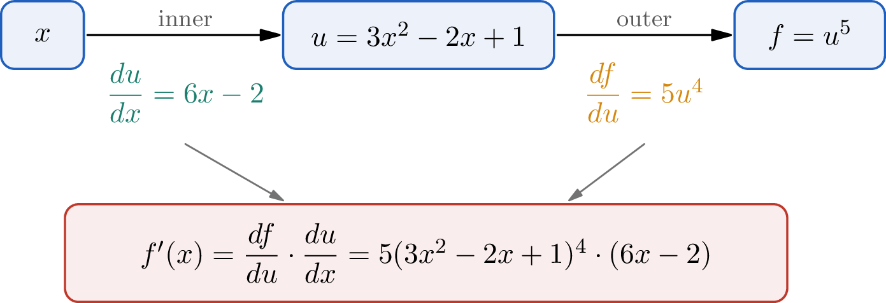

# Problem 5. The Chain Rule as Working Through Layers

## Exercise

### Problem 5. The Chain Rule as Working Through Layers
For

$$
f(x)=(3x^2-2x+1)^5
$$

identify the inner and outer functions, compute their derivatives, and combine the result according to the chain rule. Explain the origin of the additional factor.

> **Why this problem:** it teaches how to recognize the structure of a composition instead of memorizing the rule as a meaningless pattern.

---

## Answer

| Layer | Function | Derivative |
|---|---|---|
| inner | $u=g(x)=3x^2-2x+1$ | $g'(x)=6x-2$ |
| outer | $h(u)=u^5$ | $h'(u)=5u^4$ |

$$
f'(x)=5(3x^2-2x+1)^4\cdot(6x-2)=10(3x-1)(3x^2-2x+1)^4
$$

The additional factor $6x-2$ is the derivative of the inner function. It measures how fast the inner expression $u$ changes when $x$ changes; the factor $5u^4$ measures how fast $u^5$ changes when $u$ changes. The rate of the composition is the product of the two rates.

---

## Sketch

The diagram shows the two layers of the composition. The arrow from $x$ to $u$ is the inner function, with rate $\frac{du}{dx}=6x-2$; the arrow from $u$ to $f$ is the outer function, with rate $\frac{df}{du}=5u^4$. The box at the bottom multiplies the two rates along the path, which gives the derivative of $f$ with respect to $x$.

---

## Steps

### Step 1. Recognize the composition

The expression is a power, but the base is not $x$: it is a whole polynomial. The last operation performed when $f(x)$ is evaluated is raising to the fifth power. This operation is the outer function, and what it acts on is the inner function:

$$
f(x)=h\left(g(x)\right),\qquad g(x)=3x^2-2x+1,\quad h(u)=u^5
$$

### Step 2. Differentiate each layer separately

$$
g'(x)=6x-2,\qquad h'(u)=5u^4
$$

### Step 3. Combine by the chain rule

$$
f'(x)=h'\left(g(x)\right)\cdot g'(x)
$$

The outer derivative is evaluated at the inner function, $u=3x^2-2x+1$, not at $x$:

$$
f'(x)=5(3x^2-2x+1)^4\cdot(6x-2)
$$

### Step 4. Simplify

Factor $6x-2=2(3x-1)$:

$$
f'(x)=10(3x-1)(3x^2-2x+1)^4
$$

### Step 5. A consequence

The inner polynomial has discriminant $4-12\lt0$, so it is always positive and $(3x^2-2x+1)^4\gt0$. The sign of $f'(x)$ is therefore the sign of $3x-1$: negative for $x\lt\frac13$, zero at $x=\frac13$, positive for $x\gt\frac13$. The factor that decides the sign is exactly the additional factor from the inner function.

---

## Why it works

**Origin of the additional factor.** Suppose $x$ changes by a small amount $\Delta x$. Then

1. the inner value changes by $\Delta u\approx g'(x)\Delta x$,
2. the outer value changes by $\Delta f\approx h'(u)\Delta u$.

Combining the two approximations,

$$
\Delta f\approx h'(u)\ g'(x)\ \Delta x
$$

so the rate of change of $f$ with respect to $x$ is the product $h'(u)\ g'(x)$. The power rule alone gives only $h'(u)=5u^4$, the rate with respect to $u$. The factor $g'(x)$ converts it into a rate with respect to $x$. In Leibniz notation:

$$
\frac{df}{dx}=\frac{df}{du}\cdot\frac{du}{dx}
$$

**Why the power rule alone is wrong here.** The formula $5(3x^2-2x+1)^4$ would be correct if the base were $x$ itself, because then $\frac{du}{dx}=1$. Here the base changes $6x-2$ times as fast as $x$, and this rate must be included.

**Comparison with expanding.** Expanding $(3x^2-2x+1)^5$ gives a polynomial of degree $10$ with eleven coefficients to compute. The chain rule avoids this and gives a factored result from which the sign of the derivative can be read directly.

| Approach | Work | Form of the result |
|---|---|---|
| expand, then power rule | binomial-type expansion of degree $10$ | unfactored polynomial |
| chain rule | two short derivatives | factored, sign visible |

---

## Check

**Values at simple points.** $f(0)=1$, $f(1)=2^5=32$.

| $x_0$ | $f'(x_0)$ from the formula | $\frac{f(x_0+h)-f(x_0-h)}{2h}$, $h=10^{-4}$ |
|---|---|---|
| $0$ | $10\cdot(-1)\cdot1^4=-10$ | $-10.0000$ |
| $\frac13$ | $0$ | $0.0000$ |
| $1$ | $10\cdot2\cdot2^4=320$ | $320.0000$ |

✓

**A special case of the rule.** For $x=1$ the inner rate is $g'(1)=4$ and the outer rate is $h'(2)=5\cdot2^4=80$; their product is $320=f'(1)$ ✓.
