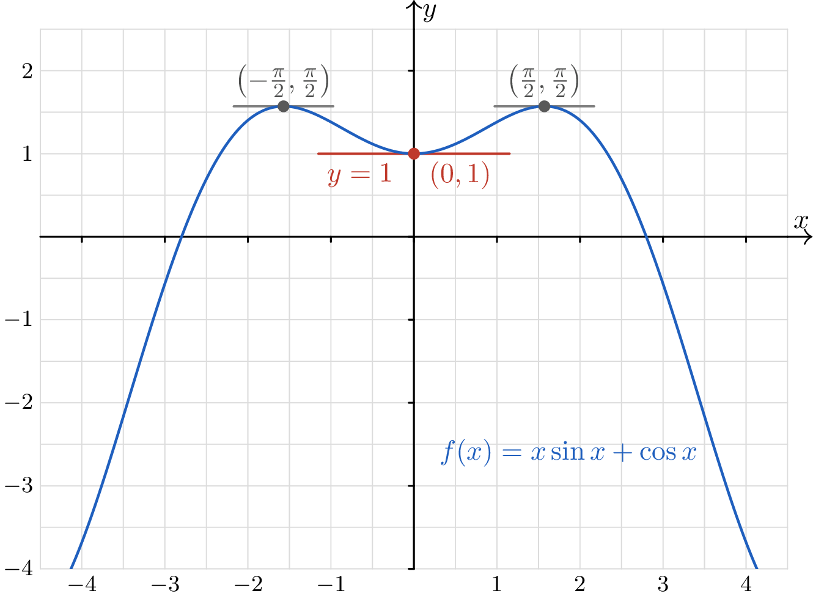

# Problem 6. Product Rule and Trigonometry

## Exercise

### Problem 6. Product Rule and Trigonometry
For

$$
f(x)=x\sin x+\cos x
$$

compute the derivative and simplify the result. Then compute $f'(0)$ and interpret the direction of the tangent line at that point.

> **Why this problem:** it combines the product rule with trigonometric derivatives and geometric interpretation.

---

## Answer

$$
f'(x)=\sin x+x\cos x-\sin x=x\cos x
$$

$$
f'(0)=0
$$

The tangent line at the point $(0,f(0))=(0,1)$ has slope $0$, so it is horizontal: $y=1$. Since $f'(x)=x\cos x$ is negative just to the left of $0$ and positive just to the right, the function decreases and then increases, and the point $(0,1)$ is a local minimum.

---

## Sketch

The blue curve is $f(x)=x\sin x+\cos x$ around the origin. The red horizontal line $y=1$ is the tangent at $(0,1)$, and near this point the curve lies above it, as expected at a local minimum. The gray points mark the other horizontal tangents in the window, at $x=\pm\frac\pi2$, where $\cos x=0$ and $f\left(\pm\frac\pi2\right)=\frac\pi2$.

---

## Steps

### Step 1. Structure

The function is a sum of two terms. The second term $\cos x$ is a basic function. The first term $x\sin x$ is a product of two functions of $x$, so it needs the product rule.

### Step 2. Differentiate the product

With $u=x$, $v=\sin x$, $u'=1$, $v'=\cos x$:

$$
(x\sin x)'=1\cdot\sin x+x\cos x=\sin x+x\cos x
$$

### Step 3. Differentiate the second term

$$
(\cos x)'=-\sin x
$$

### Step 4. Add and simplify

$$
f'(x)=\sin x+x\cos x-\sin x=x\cos x
$$

The terms $\sin x$ and $-\sin x$ cancel.

### Step 5. Value at $0$

$$
f'(0)=0\cdot\cos0=0
$$

### Step 6. Tangent line and its direction

$f(0)=0\cdot\sin0+\cos0=1$. The tangent line is

$$
y=f(0)+f'(0)(x-0)=1
$$

a horizontal line through $(0,1)$.

### Step 7. Behavior around $0$

For $-\frac\pi2\lt x\lt\frac\pi2$ the factor $\cos x$ is positive, so the sign of $f'(x)=x\cos x$ equals the sign of $x$:

| $x$ | $\left(-\frac\pi2,0\right)$ | $0$ | $\left(0,\frac\pi2\right)$ |
|---|---|---|---|
| $f'(x)$ | $-$ | $0$ | $+$ |
| $f$ | decreasing | $1$ | increasing |

The point $(0,1)$ is a local minimum, and the horizontal tangent touches the graph from below.

---

## Why it works

**Why the product rule.** In $x\sin x$ both factors depend on $x$. The derivative of a product is not the product of the derivatives: $1\cdot\cos x$ would be wrong. The product rule records the change of each factor while the other is held fixed.

**Why the result simplifies.** The product rule creates the term $u'v=\sin x$, and the derivative of $\cos x$ is $-\sin x$. The function was built so that these two cancel. The cancellation is a useful internal check: after simplification only $x\cos x$ remains.

**What a zero derivative means.** The value $f'(0)$ is the slope of the tangent line at $x=0$. Slope $0$ means a horizontal tangent: at this point the function neither increases nor decreases at the first order. A zero derivative alone does not decide between a minimum, a maximum, or neither. Here the sign change of $f'(x)$ from $-$ to $+$ shows a minimum.

| Sign of $f'(x)$ left of $x_0$ | right of $x_0$ | Conclusion |
|---|---|---|
| $-$ | $+$ | local minimum |
| $+$ | $-$ | local maximum |
| same sign | same sign | no extremum |

---

## Check

**Difference quotients.**

| $x_0$ | $f'(x_0)=x_0\cos x_0$ | $\frac{f(x_0+h)-f(x_0-h)}{2h}$, $h=10^{-4}$ |
|---|---|---|
| $0$ | $0$ | $0.0000$ |
| $1$ | $0.5403$ | $0.5403$ |
| $2$ | $-0.8323$ | $-0.8323$ |

✓

**Values near $0$.** $f(-0.1)=f(0.1)=0.1\sin0.1+\cos0.1\approx1.0050\gt1$, so the graph lies above the tangent $y=1$ on both sides of $0$, consistent with a local minimum ✓.
