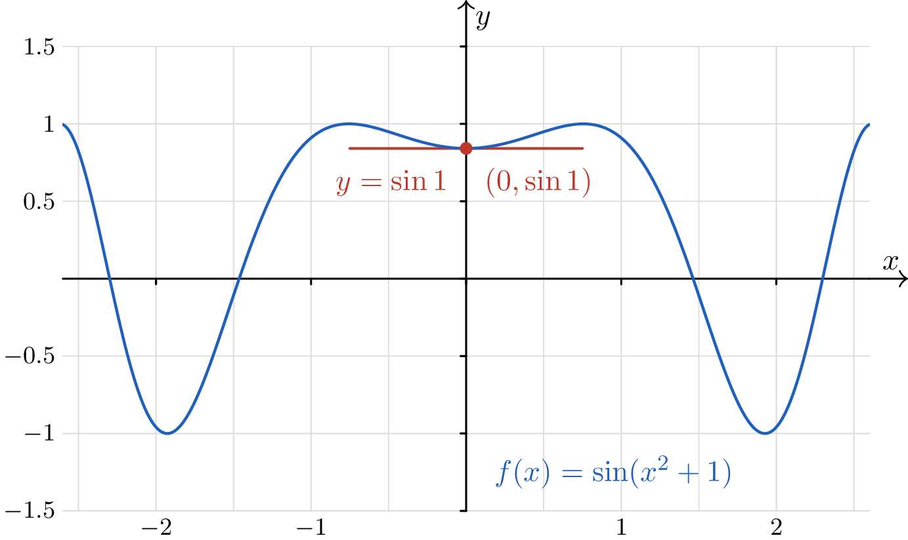

# Problem 7. A Trigonometric Composition

## Exercise

### Problem 7. A Trigonometric Composition
For

$$
f(x)=\sin(x^2+1)
$$

compute the derivative. Explicitly identify the outer function, the inner function, and the derivative of the inner function. Finally, determine the sign of $f'(0)$.

> **Why this problem:** it reinforces the chain rule in a different type of composition.

---

## Answer

| Part | Expression |
|---|---|
| outer function | $h(u)=\sin u$, with $h'(u)=\cos u$ |
| inner function | $u=g(x)=x^2+1$ |
| derivative of the inner function | $g'(x)=2x$ |

$$
f'(x)=\cos(x^2+1)\cdot2x=2x\cos(x^2+1)
$$

$$
f'(0)=0
$$

The value $f'(0)$ is neither positive nor negative: it is zero, and the tangent at $(0,\sin1)$ is horizontal. The zero comes from the inner derivative $2x$, while the outer factor $\cos1\approx0.5403$ is positive.

---

## Sketch

The blue curve is $f(x)=\sin(x^2+1)$. It is symmetric about the $y$-axis, because the inner function $x^2+1$ is even. The red horizontal line $y=\sin1\approx0.84$ is the tangent at $(0,\sin1)$, and near this point the curve lies above it. Farther from the origin the oscillations become faster, because the inner function $x^2+1$ grows faster.

---

## Steps

### Step 1. Find the layers

To evaluate $f(x)$ one first computes $x^2+1$ and then takes the sine of the result. The last operation is the sine, so it is the outer function:

$$
f(x)=h\left(g(x)\right),\qquad g(x)=x^2+1,\quad h(u)=\sin u
$$

### Step 2. Derivatives of the layers

$$
h'(u)=\cos u,\qquad g'(x)=2x
$$

### Step 3. Chain rule

$$
f'(x)=h'\left(g(x)\right)\cdot g'(x)=\cos(x^2+1)\cdot2x
$$

### Step 4. Sign at $0$

$$
f'(0)=2\cdot0\cdot\cos(0+1)=0\cdot\cos1=0
$$

The sign of $f'(0)$ is zero.

### Step 5. What happens near $0$

For $|x|\lt\sqrt{\frac\pi2-1}\approx0.7555$ the inner value satisfies $1\le x^2+1\lt\frac\pi2$, so $\cos(x^2+1)\gt0$. In this range the sign of $f'(x)$ is the sign of $2x$:

| $x$ | slightly below $0$ | $0$ | slightly above $0$ |
|---|---|---|---|
| $2x$ | $-$ | $0$ | $+$ |
| $\cos(x^2+1)$ | $+$ | $\cos1\gt0$ | $+$ |
| $f'(x)$ | $-$ | $0$ | $+$ |

The function decreases to the value $\sin1$ at $x=0$ and then increases, so $x=0$ is a local minimum.

---

## Why it works

**Why the chain rule.** The sine is not applied to $x$ but to the expression $x^2+1$. When $x$ changes, the argument of the sine changes at the rate $2x$, and the sine responds at the rate $\cos u$. The total rate is the product. Writing $\cos(x^2+1)$ alone would treat the argument as if it changed at rate $1$.

**Two factors, two roles.** Each factor of $f'(x)=2x\cos(x^2+1)$ can make the derivative zero:

| Factor | Zero when | Meaning |
|---|---|---|
| $2x$ | $x=0$ | the inner function has a horizontal tangent: $x^2+1$ is momentarily not changing |
| $\cos(x^2+1)$ | $x^2+1=\frac\pi2+k\pi$ | the sine is at a crest or trough |

At $x=0$ the zero comes from the inner layer: at the vertex of the parabola $x^2+1$ the argument of the sine stops changing for an instant, so the sine stops changing too.

**Symmetry.** Since $f(-x)=f(x)$, the graph is symmetric about the $y$-axis. The derivative of an even differentiable function is odd, so $f'(0)=-f'(0)$, which again gives $f'(0)=0$.

---

## Check

**Difference quotients.**

| $x_0$ | $2x_0\cos(x_0^2+1)$ | $\frac{f(x_0+h)-f(x_0-h)}{2h}$, $h=10^{-4}$ |
|---|---|---|
| $0$ | $0$ | $0.0000$ |
| $0.5$ | $0.3153$ | $0.3153$ |
| $1$ | $-0.8323$ | $-0.8323$ |

✓

**Values near $0$.** $f(\pm0.1)=\sin1.01\approx0.8468\gt\sin1\approx0.8415$, so the graph is above the horizontal tangent on both sides ✓.
