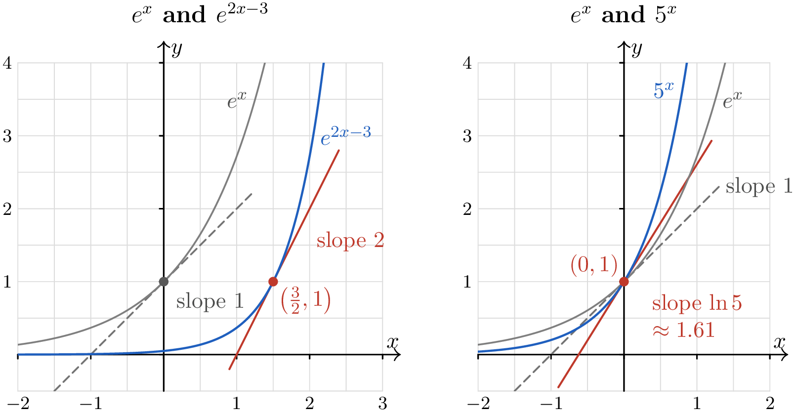

# Problem 8. Two Exponential Functions

## Exercise

### Problem 8. Two Exponential Functions
For

$$
f(x)=e^{2x-3}+5^x
$$

compute the derivative. Explain why the factor $2$ appears in the first term and why $\ln5$ appears in the second.

> **Why this problem:** it organizes two different mechanisms that produce additional factors.

---

## Answer

$$
f'(x)=2e^{2x-3}+5^x\ln5
$$

| Term | Mechanism | Additional factor |
|---|---|---|
| $e^{2x-3}$ | chain rule: the exponent $2x-3$ is an inner function with derivative $2$ | $2$ |
| $5^x$ | change of base: $5^x=e^{x\ln5}$, the exponent $x\ln5$ has derivative $\ln5$ | $\ln5\approx1.6094$ |

The factor $2$ is the rate at which the exponent $2x-3$ changes. The factor $\ln5$ is the rate at which the exponent changes after the base $5$ has been rewritten as a power of $e$. Only for the base $e$ itself is this factor equal to $1$.

---

## Sketch

Left panel: the gray curve $y=e^x$ and the blue curve $y=e^{2x-3}$, each with its tangent at the height $1$ (gray dashed for $e^x$, red for $e^{2x-3}$). For $e^x$ this happens at $x=0$ and the slope is $1$; for $e^{2x-3}$ it happens at $x=\frac32$ and the slope is $2$. The curve $e^{2x-3}$ is $e^x$ compressed horizontally by the factor $2$, so all its slopes are doubled. Right panel: the gray curve $y=e^x$ and the blue curve $y=5^x$ both pass through $(0,1)$; the gray dashed tangent of $e^x$ has slope $1$ and the red tangent of $5^x$ has slope $\ln5\approx1.61$.

---

## Steps

### Step 1. Split the sum

The derivative of a sum is the sum of the derivatives:

$$
f'(x)=\left(e^{2x-3}\right)'+\left(5^x\right)'
$$

### Step 2. First term: chain rule

The function $e^{2x-3}$ is a composition with outer function $e^u$ and inner function $u=2x-3$:

$$
\left(e^u\right)'=e^u,\qquad u'=2
$$

$$
\left(e^{2x-3}\right)'=e^{2x-3}\cdot2=2e^{2x-3}
$$

### Step 3. Second term: rewrite the base

The rule $\left(e^x\right)'=e^x$ holds only for the base $e$. Every positive base can be written as a power of $e$, since $5=e^{\ln5}$:

$$
5^x=\left(e^{\ln5}\right)^x=e^{x\ln5}
$$

Now the chain rule applies with inner function $u=x\ln5$, whose derivative is the constant $\ln5$:

$$
\left(5^x\right)'=e^{x\ln5}\cdot\ln5=5^x\ln5
$$

### Step 4. Combine

$$
f'(x)=2e^{2x-3}+5^x\ln5
$$

Both terms are positive for every $x$, so $f$ is increasing on the whole real line.

---

## Why it works

**Two mechanisms, one source.** Both factors are inner derivatives in the chain rule. The difference is where the inner function comes from.

- In $e^{2x-3}$ the inner function $2x-3$ is written explicitly. Its derivative $2$ appears as soon as the composition is recognized.
- In $5^x$ the inner function is hidden. It appears only after rewriting $5^x=e^{x\ln5}$, and its derivative is $\ln5$.

**Why the base $e$ is special.** For any base $a\gt0$,

$$
\left(a^x\right)'=a^x\ln a
$$

The derivative is proportional to the function itself, with proportionality constant $\ln a$. The number $e$ is exactly the base for which this constant equals $1$, because $\ln e=1$. Geometrically, $\ln a$ is the slope of the tangent to $y=a^x$ at the point $(0,1)$:

| Base $a$ | $2$ | $e$ | $5$ |
|---|---|---|---|
| slope at $(0,1)$: $\ln a$ | $0.6931$ | $1$ | $1.6094$ |

**Why the factor $2$ doubles every slope.** The graph of $e^{2x-3}$ takes the values of $e^u$ but reaches them twice as fast: when $x$ increases by $\Delta x$, the exponent increases by $2\Delta x$. Each slope of $e^u$ is therefore multiplied by $2$. The shift by $-3$ moves the graph but does not change slopes, which is why $-3$ leaves no factor.

---

## Check

**Difference quotients.**

| $x_0$ | $2e^{2x_0-3}+5^{x_0}\ln5$ | $\frac{f(x_0+h)-f(x_0-h)}{2h}$, $h=10^{-4}$ |
|---|---|---|
| $0$ | $1.7090$ | $1.7090$ |
| $1$ | $8.7829$ | $8.7829$ |
| $1.5$ | $19.9941$ | $19.9941$ |

✓

**The tangent slope of $5^x$ at $0$.** For $h=0.001$: $\frac{5^{0.001}-1}{0.001}\approx1.6107$, close to $\ln5\approx1.6094$ ✓.
