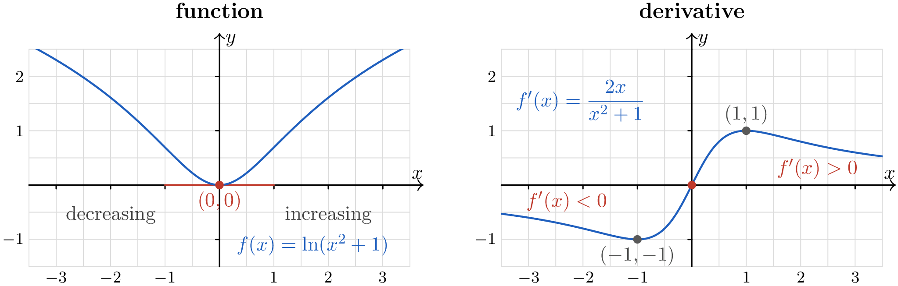

# Problem 9. A Logarithm and the Chain Rule

## Exercise

### Problem 9. A Logarithm and the Chain Rule
For

$$
f(x)=\ln(x^2+1)
$$

compute the derivative. Then determine the sign of $f'(x)$ for $x\lt0$, $x=0$, and $x\gt0$, and describe qualitatively how the function behaves around zero.

> **Why this problem:** it connects differentiation with sign analysis and the behavior of a function.

---

## Answer

$$
f'(x)=\frac{2x}{x^2+1}
$$

| $x$ | $x\lt0$ | $x=0$ | $x\gt0$ |
|---|---|---|---|
| sign of $f'(x)$ | $-$ | $0$ | $+$ |
| behavior of $f$ | decreasing | horizontal tangent, $f(0)=0$ | increasing |

The function decreases on $(-\infty,0]$, reaches its smallest value $f(0)=\ln1=0$ at $x=0$, and increases on $[0,\infty)$. The point $(0,0)$ is the global minimum, and the graph is symmetric about the $y$-axis.

---

## Sketch

Left panel: the graph of $f(x)=\ln(x^2+1)$ falls towards the origin, touches the horizontal tangent $y=0$ at $(0,0)$, and rises again. Right panel: the derivative $f'(x)=\frac{2x}{x^2+1}$ lies below the $x$-axis for $x\lt0$, crosses it at $0$, and lies above it for $x\gt0$; the red labels mark the sign on each side. The extreme values of the derivative are $-1$ and $1$ at $x=-1$ and $x=1$, where $f$ falls and rises most steeply.

---

## Steps

### Step 1. Structure

The logarithm is applied to the expression $x^2+1$, not to $x$. This is a composition:

$$
f(x)=h\left(g(x)\right),\qquad g(x)=x^2+1,\quad h(u)=\ln u
$$

Since $x^2+1\ge1\gt0$ for every $x$, the function is defined on the whole real line.

### Step 2. Derivatives of the layers

$$
h'(u)=\frac1u,\qquad g'(x)=2x
$$

### Step 3. Chain rule

$$
f'(x)=\frac1{x^2+1}\cdot2x=\frac{2x}{x^2+1}
$$

### Step 4. Sign analysis

The denominator $x^2+1$ is positive for every $x$. Therefore the sign of $f'(x)$ is the sign of the numerator $2x$:

- for $x\lt0$: $2x\lt0$, so $f'(x)\lt0$;
- for $x=0$: $f'(0)=0$;
- for $x\gt0$: $2x\gt0$, so $f'(x)\gt0$.

### Step 5. Behavior around zero

A negative derivative on an interval means that the function decreases there, a positive one that it increases. The function decreases until $x=0$ and increases afterwards, so it has a minimum at $x=0$:

$$
f(0)=\ln(0+1)=\ln1=0
$$

Since $x^2+1\ge1$ and $\ln$ is increasing, $f(x)\ge\ln1=0$ for every $x$, so the minimum is global. Near $0$ the graph is flat, with horizontal tangent $y=0$. For large $|x|$ the function keeps growing, but slowly: $f'(x)\to0$ as $|x|\to\infty$.

---

## Why it works

**Why the chain rule.** The rule $(\ln x)'=\frac1x$ applies to the logarithm of $x$. Here the logarithm is applied to $x^2+1$, which changes at the rate $2x$. The chain rule multiplies the rate of the logarithm, $\frac1u$, by the rate of the inner function, $2x$. A frequent error is to write $\frac1{x^2+1}$, which omits the inner derivative.

**Why the sign of the derivative describes the behavior.** If $f'(x)\lt0$ at every point of an interval, then by the mean value theorem, for any $a\lt b$ in that interval

$$
f(b)-f(a)=f'(c)(b-a)\lt0
$$

for some $c$ between $a$ and $b$. So the function decreases on the interval. The same argument with $f'(x)\gt0$ gives an increasing function.

**Sign analysis of a fraction.** For a quotient the sign is decided by the factors that can change sign. Here the denominator is always positive, so only the numerator matters. The single sign change of $2x$ at $x=0$ is the single turning point of $f$.

**Symmetry.** The inner function $x^2+1$ is even, so $f$ is even and its derivative is odd. This is visible in the result: $f'(-x)=-f'(x)$.

---

## Check

**Difference quotients.**

| $x_0$ | $\frac{2x_0}{x_0^2+1}$ | $\frac{f(x_0+h)-f(x_0-h)}{2h}$, $h=10^{-4}$ |
|---|---|---|
| $-1$ | $-1$ | $-1.0000$ |
| $0$ | $0$ | $0.0000$ |
| $1$ | $1$ | $1.0000$ |
| $2$ | $0.8$ | $0.8000$ |

✓

**Values around zero.**

| $x$ | $-1$ | $-0.5$ | $0$ | $0.5$ | $1$ |
|---|---|---|---|---|---|
| $f(x)$ | $0.6931$ | $0.2231$ | $0$ | $0.2231$ | $0.6931$ |

The values decrease to $0$ and then increase, symmetric about $x=0$ ✓.
