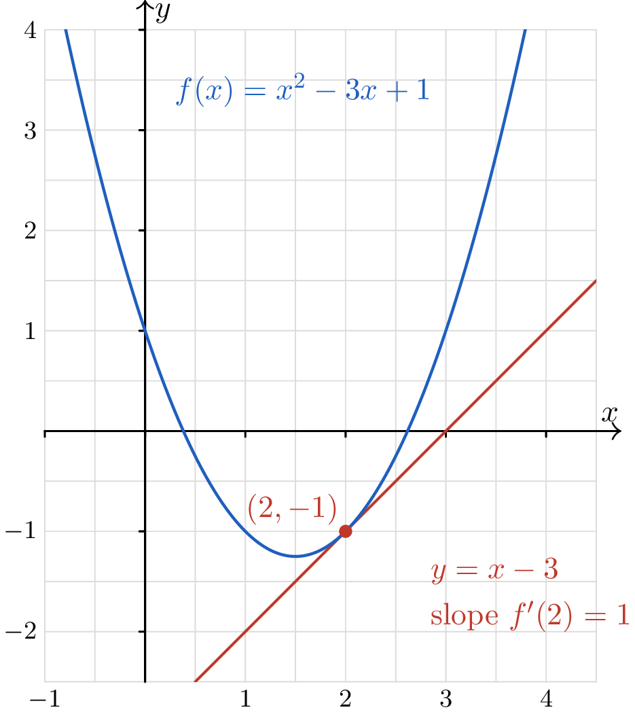

# Problem 10. The Tangent Line as an Application of the Derivative

## Exercise

### Problem 10. The Tangent Line as an Application of the Derivative
For

$$
f(x)=x^2-3x+1
$$

find the equation of the tangent line at the point with $x=2$. Give the point of tangency, the value $f'(2)$, the equation of the line, and verify that the point lies on the obtained tangent line.

> **Why this problem:** it combines the derivative and the equation of a line into a complete geometric problem.

---

## Answer

| Item | Result |
|---|---|
| point of tangency | $(2,-1)$ |
| slope | $f'(2)=1$ |
| tangent line | $y=x-3$ |
| verification | $2-3=-1$, so $(2,-1)$ lies on the line |

$$
y=x-3
$$

---

## Sketch

The blue parabola $y=x^2-3x+1$ has its vertex at $(1.5,-1.25)$. The red line $y=x-3$ touches it at $(2,-1)$ and rises at $45^\circ$, since its slope is $1$. The parabola lies above the tangent on both sides of the point of tangency. The axes use the same unit, so the angle is shown correctly.

---

## Steps

### Step 1. Point of tangency

$$
f(2)=2^2-3\cdot2+1=4-6+1=-1
$$

The point of tangency is $(2,-1)$.

### Step 2. Derivative and slope

By the power rule and linearity,

$$
f'(x)=2x-3
$$

$$
f'(2)=2\cdot2-3=1
$$

### Step 3. Equation of the tangent line

A line through the point $(x_0,y_0)$ with slope $m$ has the equation $y=y_0+m(x-x_0)$. With $x_0=2$, $y_0=f(2)=-1$, $m=f'(2)=1$:

$$
y=-1+1\cdot(x-2)=x-3
$$

### Step 4. Verify the point

Substituting $x=2$ into the equation of the line:

$$
y=2-3=-1
$$

This equals $f(2)$, so the point $(2,-1)$ lies on the tangent line.

---

## Why it works

**Two pieces of information determine a line.** A non-vertical line is fixed by one point and its slope. The tangent line must pass through the point of the graph, which gives $(x_0,f(x_0))$, and must have the same direction as the graph there, which gives the slope $f'(x_0)$. The point-slope form combines the two:

$$
y=f(x_0)+f'(x_0)(x-x_0)
$$

**Why the derivative is the right slope.** The slope of the secant through $(2,f(2))$ and $(2+h,f(2+h))$ is

$$
\frac{f(2+h)-f(2)}h=\frac{(2+h)^2-3(2+h)+1+1}h=\frac{h+h^2}h=1+h
$$

As $h\to0$ the secants approach a limiting line with slope $1=f'(2)$, and that limiting line is the tangent.

**The tangent as the best linear approximation.** The difference between the function and the tangent line is

$$
f(x)-(x-3)=x^2-4x+4=(x-2)^2
$$

It vanishes at $x=2$ to second order: near the point of tangency the error is much smaller than the distance $|x-2|$. No other line through $(2,-1)$ has this property. The difference is also never negative, which is why the parabola stays above its tangent.

**Why the verification matters.** The verification in Step 4 checks that the line passes through the right point. It catches arithmetic errors in $f(2)$ or in the expansion of $y_0+m(x-x_0)$. It does not check the slope; that is done separately below.

---

## Check

**The point lies on both the graph and the line.**

$$
f(2)=-1,\qquad 2-3=-1\ \checkmark
$$

**The slope.** Difference quotients $\frac{f(2+h)-f(2)}h=1+h$:

| $h$ | $0.1$ | $0.01$ | $0.001$ |
|---|---|---|---|
| quotient | $1.1$ | $1.01$ | $1.001$ |

The quotients approach $1$ ✓.

**Tangency.** The equation $x^2-3x+1=x-3$ is equivalent to $(x-2)^2=0$, which has the double root $x=2$. The line meets the parabola at exactly one point and does not cross it ✓.
