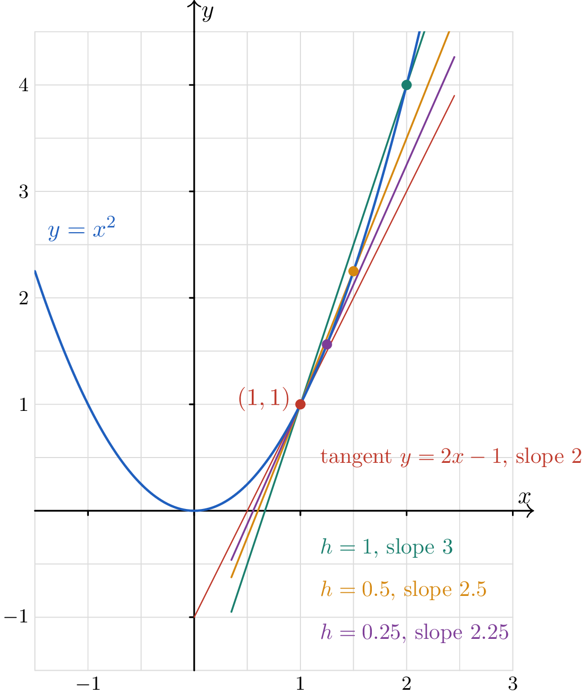

# Problem 11. Derivative from the Definition

## Exercise

### Problem 11. Derivative from the Definition
Using only

$$
f'(x)=\lim_{h\to0}\frac{f(x+h)-f(x)}h,
$$

find the derivative of $f(x)=x^2$. Compare the result with the power rule and indicate where the limit is used in the calculation.

> **Why this problem:** it shows the origin of the power rule and the direct connection between the derivative and a limit.

---

## Answer

$$
f'(x)=\lim_{h\to0}\frac{(x+h)^2-x^2}h=\lim_{h\to0}(2x+h)=2x
$$

The result agrees with the power rule $\left(x^n\right)'=nx^{n-1}$ for $n=2$.

The limit is used in exactly one place: in the last step, where $h\to0$ is applied to the simplified expression $2x+h$. All earlier steps are algebra with a fixed $h\neq0$.

---

## Sketch

The blue parabola is $y=x^2$. The green, orange, and purple lines are secants through $(1,1)$ and $(1+h,(1+h)^2)$ for $h=1$, $0.5$, $0.25$, with slopes $2x+h=3$, $2.5$, $2.25$. The red line is the tangent $y=2x-1$ with slope $2$. As $h$ decreases, the second point slides towards $(1,1)$ and the secants turn towards the tangent.

---

## Steps

### Step 1. Write the difference quotient

For a fixed $x$ and a fixed $h\neq0$:

$$
\frac{f(x+h)-f(x)}h=\frac{(x+h)^2-x^2}h
$$

### Step 2. Expand the numerator

$$
(x+h)^2-x^2=x^2+2xh+h^2-x^2=2xh+h^2
$$

### Step 3. Divide by $h$

Since $h\neq0$, the common factor $h$ can be canceled:

$$
\frac{2xh+h^2}h=\frac{h(2x+h)}h=2x+h
$$

### Step 4. Pass to the limit

This is the only step that uses the limit. The expression $2x+h$ is a polynomial in $h$, hence continuous in $h$, and its value at $h=0$ is $2x$:

$$
f'(x)=\lim_{h\to0}(2x+h)=2x
$$

### Step 5. Compare with the power rule

The power rule with $n=2$ gives

$$
\left(x^2\right)'=2x^{2-1}=2x
$$

The two results agree. The calculation above is a proof of the power rule in the case $n=2$.

---

## Why it works

**Where the limit is needed and why.** The difference quotient cannot be evaluated at $h=0$: it would be $\frac00$. The limit replaces evaluation at $h=0$ by the behavior for $h$ near $0$ but different from $0$. Steps 1 to 3 hold for every $h\neq0$; they transform the quotient into a form, $2x+h$, that has a limit visible by substitution. Step 4 is the only limit operation.

| Step | Operation | Uses the limit? |
|---|---|---|
| 1 | write the difference quotient | no |
| 2 | expand $(x+h)^2$ | no |
| 3 | cancel $h$, valid because $h\neq0$ | no |
| 4 | let $h\to0$ in $2x+h$ | yes |

**Geometric meaning.** The quotient $2x+h$ is the slope of the secant through $(x,x^2)$ and $(x+h,(x+h)^2)$. The term $h$ is the excess of the secant slope over the tangent slope. It disappears in the limit, and what remains, $2x$, is the slope of the tangent.

**The general power rule from the same idea.** For a positive integer $n$ the binomial theorem gives

$$
\frac{(x+h)^n-x^n}h=nx^{n-1}+\binom n2x^{n-2}h+\dots+h^{n-1}
$$

Every term except the first contains a factor $h$ and vanishes as $h\to0$, which leaves $nx^{n-1}$. The case $n=2$ above is the simplest instance.

---

## Check

**Secant slopes at $x=1$.** The quotient equals $2+h$:

| $h$ | $1$ | $0.5$ | $0.25$ | $0.01$ | $-0.01$ |
|---|---|---|---|---|---|
| $\frac{(1+h)^2-1}h$ | $3$ | $2.5$ | $2.25$ | $2.01$ | $1.99$ |

The slopes approach $f'(1)=2$ from both sides ✓.

**Another point.** At $x=-3$: $\frac{(-3+h)^2-9}h=-6+h\to-6=2\cdot(-3)$ ✓.
