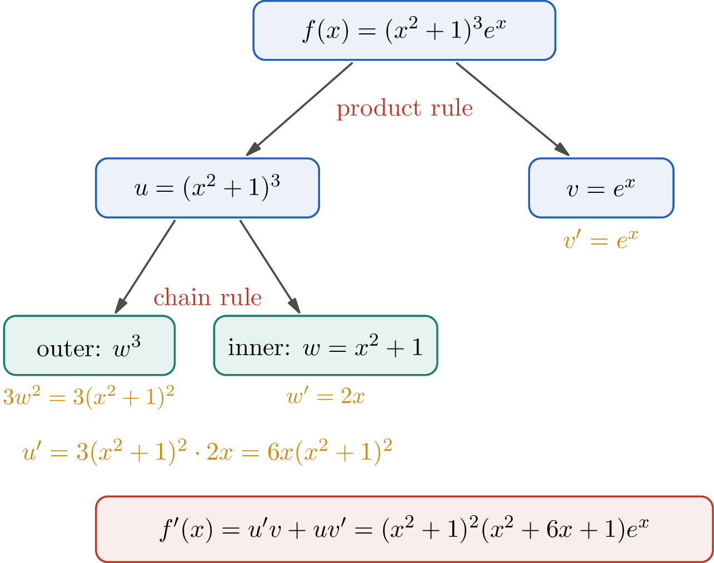

# Problem 12. Several Rules at Once

## Exercise

### Problem 12. Several Rules at Once
For

$$
f(x)=(x^2+1)^3e^x
$$

compute the derivative. Before calculating, write down a plan: which rule applies to the whole expression and which rule applies to one of its factors. Finally, organize the result by factoring out common factors.

> **Why this problem:** it practices the order of decisions when combining familiar differentiation rules.

---

## Answer

**Plan.**

1. The whole expression is a product of $u=(x^2+1)^3$ and $v=e^x$: the product rule applies to the whole.
2. The factor $u=(x^2+1)^3$ is a composition, a cube of the inner function $x^2+1$: the chain rule applies to this factor.
3. The factor $v=e^x$ is a basic function with $v'=e^x$.

**Result.**

$$
f'(x)=6x(x^2+1)^2e^x+(x^2+1)^3e^x=(x^2+1)^2\left(x^2+6x+1\right)e^x
$$

---

## Sketch

The diagram shows the plan as a tree. The top box is the whole function, which is split by the product rule into the factors $(x^2+1)^3$ and $e^x$. The left factor is split once more by the chain rule into the outer function $w^3$ and the inner function $w=x^2+1$. The derivative of each piece is written under its box, and the red box at the bottom assembles them by the product rule.

---

## Steps

### Step 1. Product rule for the whole expression

The last operation in evaluating $f(x)$ is the multiplication of $(x^2+1)^3$ by $e^x$. Therefore the outermost rule is the product rule:

$$
f'(x)=u'v+uv',\qquad u=(x^2+1)^3,\quad v=e^x
$$

### Step 2. Chain rule for the first factor

With inner function $w=x^2+1$, $w'=2x$, and outer function $w^3$:

$$
u'=3(x^2+1)^2\cdot2x=6x(x^2+1)^2
$$

### Step 3. Derivative of the second factor

$$
v'=e^x
$$

### Step 4. Assemble

$$
f'(x)=6x(x^2+1)^2e^x+(x^2+1)^3e^x
$$

### Step 5. Factor out common factors

Both terms contain $(x^2+1)^2$ and $e^x$. The second term contains one more factor $x^2+1$:

$$
f'(x)=(x^2+1)^2e^x\left[6x+(x^2+1)\right]=(x^2+1)^2\left(x^2+6x+1\right)e^x
$$

---

## Why it works

**The order of decisions follows the order of evaluation, reversed.** To evaluate $f(x)$ one computes $x^2+1$, then cubes it, computes $e^x$, and finally multiplies. The last operation decides the first rule. Then each factor is treated in the same way.

| Level | Expression | Last operation | Rule |
|---|---|---|---|
| whole | $(x^2+1)^3e^x$ | multiplication | product rule |
| first factor | $(x^2+1)^3$ | cube | chain rule |
| inner function | $x^2+1$ | sum | linearity, power rule |
| second factor | $e^x$ | basic function | $\left(e^x\right)'=e^x$ |

Starting with the chain rule would be wrong: the whole expression is not of the form $h(g(x))$ for a single outer $h$, because $e^x$ is not inside the cube.

**Why factoring out is useful.** The factored form shows the sign of the derivative:

- $(x^2+1)^2\gt0$ and $e^x\gt0$ for every $x$;
- the sign of $f'(x)$ is the sign of $x^2+6x+1$, which vanishes at $x=-3\pm2\sqrt2$, that is, at $x\approx-5.8284$ and $x\approx-0.1716$.

| Interval | $(-\infty,-3-2\sqrt2)$ | $(-3-2\sqrt2,-3+2\sqrt2)$ | $(-3+2\sqrt2,\infty)$ |
|---|---|---|---|
| sign of $f'(x)$ | $+$ | $-$ | $+$ |

The unfactored sum gives none of this information directly.

**Comparison with Problem 3.** Problem 3 had $(x^2+1)e^x$ and needed only the product rule. Raising the first factor to the third power adds one level to the structure, and with it the chain rule for that factor.

---

## Check

**Difference quotients.**

| $x_0$ | $(x_0^2+1)^2(x_0^2+6x_0+1)e^{x_0}$ | $\frac{f(x_0+h)-f(x_0-h)}{2h}$, $h=10^{-4}$ |
|---|---|---|
| $-1$ | $4\cdot(-4)\cdot e^{-1}\approx-5.8861$ | $-5.8861$ |
| $0$ | $1$ | $1.0000$ |
| $1$ | $4\cdot8\cdot e\approx86.9850$ | $86.9850$ |

✓

**Expansion of the factored form.**

$$
(x^2+1)^2\left(x^2+6x+1\right)e^x=(x^2+1)^2\cdot6x\ e^x+(x^2+1)^2(x^2+1)e^x\ \checkmark
$$
