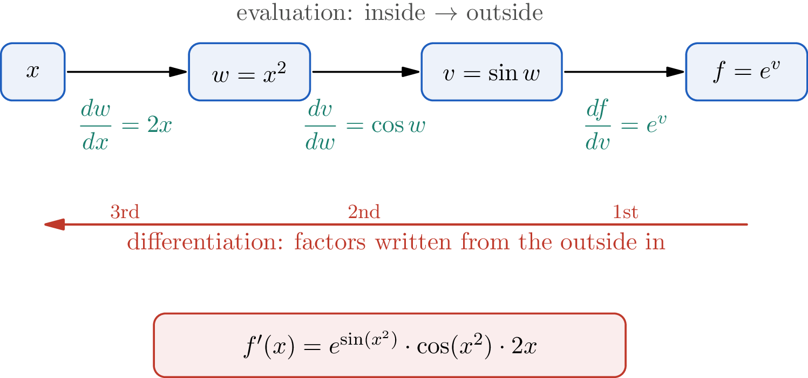

# Problem 13. A Multi-Layer Composition

## Exercise

### Problem 13. A Multi-Layer Composition
For

$$
f(x)=e^{\sin(x^2)}
$$

compute the derivative. First write the layers

$$
x\longrightarrow x^2\longrightarrow \sin(x^2)\longrightarrow e^{\sin(x^2)}
$$

and explain why differentiation moves through them in the reverse order.

> **Why this problem:** it develops the chain rule as a method for working with multiple layers.

---

## Answer

$$
f'(x)=e^{\sin(x^2)}\cdot\cos(x^2)\cdot2x=2x\cos(x^2)\ e^{\sin(x^2)}
$$

| Layer | Function | Derivative of the layer |
|---|---|---|
| 1 (innermost) | $w=x^2$ | $\frac{dw}{dx}=2x$ |
| 2 | $v=\sin w$ | $\frac{dv}{dw}=\cos w=\cos(x^2)$ |
| 3 (outermost) | $f=e^v$ | $\frac{df}{dv}=e^v=e^{\sin(x^2)}$ |

Evaluation goes from the inside out: first $x^2$, then the sine, then the exponential. Differentiation starts with the outermost layer because the chain rule $\left(h(g(x))\right)'=h'(g(x))\ g'(x)$ treats everything inside $h$ as one block: the outer derivative is taken first, evaluated at the unchanged inner block, and only then is the block itself differentiated. Repeating this peels the layers off from the outside in.

---

## Sketch

The upper row shows evaluation from left to right: $x\mapsto w=x^2\mapsto v=\sin w\mapsto f=e^v$. Each arrow carries the derivative of its layer. The lower red arrow runs from right to left and shows the order in which the factors are written when differentiating: first $e^{\sin(x^2)}$, then $\cos(x^2)$, then $2x$.

---

## Steps

### Step 1. Name the layers

$$
w=x^2,\qquad v=\sin w,\qquad f=e^v
$$

### Step 2. Outermost layer

The last operation is the exponential. Its derivative, evaluated at the whole inner block $v=\sin(x^2)$:

$$
f'(x)=e^{\sin(x^2)}\cdot\left(\sin(x^2)\right)'
$$

### Step 3. Middle layer

The remaining block $\sin(x^2)$ is itself a composition, a sine of $w=x^2$:

$$
\left(\sin(x^2)\right)'=\cos(x^2)\cdot\left(x^2\right)'
$$

### Step 4. Innermost layer

$$
\left(x^2\right)'=2x
$$

### Step 5. Collect the factors

$$
f'(x)=e^{\sin(x^2)}\cdot\cos(x^2)\cdot2x=2x\cos(x^2)\ e^{\sin(x^2)}
$$

### Step 6. Sign and special values

The factor $e^{\sin(x^2)}$ is always positive, so the sign of $f'(x)$ is the sign of $2x\cos(x^2)$. In particular $f'(0)=0$, and for $0\lt x\lt\sqrt{\pi/2}\approx1.2533$ both $2x$ and $\cos(x^2)$ are positive, so the function increases there.

---

## Why it works

**Why the order is reversed.** The chain rule for two layers is

$$
\frac{df}{dx}=\frac{df}{dv}\cdot\frac{dv}{dx}
$$

and the second factor is again a composition, so it splits further:

$$
\frac{df}{dx}=\frac{df}{dv}\cdot\frac{dv}{dw}\cdot\frac{dw}{dx}
$$

The formula always starts by differentiating the outermost function with respect to its own argument, while the argument is kept as a block. Only after that is the block opened. Evaluation builds the function from the inside out; differentiation takes it apart from the outside in, like removing the layers of an onion.

**Why each derivative is evaluated at the original inner expression.** The factor $\frac{df}{dv}=e^v$ is the rate of the exponential at the point where it actually operates, $v=\sin(x^2)$. Writing $e^x$ or $e^{x^2}$ instead would evaluate the rate at the wrong place. The same holds for the middle layer: its rate is $\cos w$ at $w=x^2$, so $\cos(x^2)$ and not $\cos x$.

**Rates multiply.** A small change $\Delta x$ produces $\Delta w\approx2x\ \Delta x$, then $\Delta v\approx\cos(x^2)\Delta w$, then $\Delta f\approx e^{\sin(x^2)}\Delta v$. Substituting one into the next multiplies the three rates. The product does not depend on the order of the factors, but working from the outside in guarantees that no layer is skipped.

| Common error | Cause |
|---|---|
| $e^{\sin(x^2)}\cos(x^2)$ | innermost layer forgotten |
| $e^{\sin(x^2)}\cdot2x$ | middle layer forgotten |
| $e^{\cos(x^2)}\cdot2x$ | outer derivative evaluated at the wrong argument |

---

## Check

**Difference quotients.**

| $x_0$ | $2x_0\cos(x_0^2)e^{\sin(x_0^2)}$ | $\frac{f(x_0+h)-f(x_0-h)}{2h}$, $h=10^{-4}$ |
|---|---|---|
| $0.5$ | $1.2409$ | $1.2409$ |
| $1$ | $2.5068$ | $2.5068$ |
| $1.5$ | $-4.1031$ | $-4.1031$ |

✓

**The sign at $x_0=1.5$.** Since $1.5^2=2.25\gt\frac\pi2\approx1.5708$, the factor $\cos(2.25)\approx-0.6282$ is negative, which explains the negative derivative ✓.
