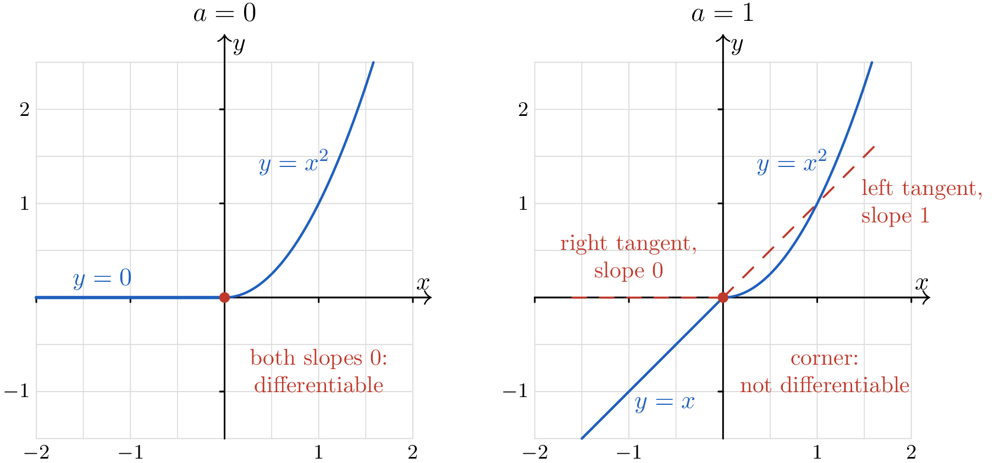

# Problem 14. Continuity and Differentiability of a Piecewise Function

## Exercise

### Problem 14. Continuity and Differentiability of a Piecewise Function
Investigate the behavior at $x=0$ of

$$
f(x)=
\begin{cases}
x^2,&x\ge0, \\
ax,&x<0.
\end{cases}
$$

For which values of $a$ is the function continuous? For which values do the one-sided derivatives exist and agree? For which value of $a$ is the function differentiable? Explain why continuity alone is not sufficient.

> **Why this problem:** it requires an organized argument and a clear distinction between two concepts.

---

## Answer

| Question | Answer |
|---|---|
| continuous at $0$ | for every real $a$ |
| right-hand derivative exists | for every real $a$, with $f'_+(0)=0$ |
| left-hand derivative exists | for every real $a$, with $f'_-(0)=a$ |
| one-sided derivatives agree | only for $a=0$ |
| differentiable at $0$ | only for $a=0$, with $f'(0)=0$ |

Continuity alone is not sufficient because it only requires the two branches to meet at the same point. Differentiability requires in addition that they arrive there with the same slope. For $a\neq0$ the branches meet at $(0,0)$ but form a corner: the left branch has slope $a$, the right branch slope $0$.

---

## Sketch

Left panel, $a=0$: the left branch is the half-line $y=0$, and the parabola $y=x^2$ leaves the origin horizontally. Both branches have slope $0$ at the origin, and the graph is smooth there. Right panel, $a=1$: the left branch is the half-line $y=x$, with slope $1$, while the parabola still starts with slope $0$. The red dashed lines continue each one-sided tangent past the origin: the left tangent (slope $1$) is drawn on the right side, and the right tangent (slope $0$) on the left side. The two lines make an angle at the origin, which is the corner. In both panels the function is continuous: the branches meet at $(0,0)$.

---

## Steps

### Step 1. Value at $0$

The point $x=0$ belongs to the branch $x\ge0$:

$$
f(0)=0^2=0
$$

### Step 2. One-sided limits

$$
\lim_{x\to0^+}f(x)=\lim_{x\to0^+}x^2=0,\qquad \lim_{x\to0^-}f(x)=\lim_{x\to0^-}ax=0
$$

Both limits equal $f(0)=0$ for every value of $a$. The function is continuous at $0$ for every real $a$.

### Step 3. Right-hand derivative

For $h\gt0$ the point $0+h$ lies in the branch $x^2$:

$$
f'_+(0)=\lim_{h\to0^+}\frac{f(h)-f(0)}h=\lim_{h\to0^+}\frac{h^2-0}h=\lim_{h\to0^+}h=0
$$

### Step 4. Left-hand derivative

For $h\lt0$ the point $0+h$ lies in the branch $ax$, while $f(0)$ is still taken from the branch $x^2$:

$$
f'_-(0)=\lim_{h\to0^-}\frac{f(h)-f(0)}h=\lim_{h\to0^-}\frac{ah-0}h=a
$$

Both one-sided derivatives exist for every $a$.

### Step 5. Agreement and differentiability

The function is differentiable at $0$ exactly when the two one-sided derivatives are equal:

$$
f'_-(0)=f'_+(0)\quad\Longleftrightarrow\quad a=0
$$

For $a=0$ the derivative is $f'(0)=0$, and the function

$$
f(x)=
\begin{cases}
x^2, & x\ge0, \\
0, & x\lt0
\end{cases}
$$

is differentiable on the whole real line, with $f'(x)=0$ for $x\lt0$ and $f'(x)=2x$ for $x\ge0$.

---

## Why it works

**Two conditions of different strength.**

| Concept | Condition at $0$ | Geometric meaning |
|---|---|---|
| continuity | $\lim_{x\to0}f(x)=f(0)$ | the branches meet, no jump |
| differentiability | $\lim_{h\to0}\frac{f(h)-f(0)}h$ exists | the branches meet with the same slope, no corner |

Continuity is about values; differentiability is about slopes. Here both branches pass through the origin for every $a$, because $ax$ and $x^2$ both vanish at $0$. That settles continuity. The slopes of the branches at the origin are $a$ and $0$, and they agree only for $a=0$.

**Why differentiability implies continuity, but not conversely.** If $f'(0)$ exists, then

$$
f(h)-f(0)=\frac{f(h)-f(0)}h\cdot h\to f'(0)\cdot0=0
$$

so $f$ is continuous at $0$. The converse fails: continuity makes the numerator $f(h)-f(0)$ tend to $0$, but says nothing about how fast compared with $h$. For $a\neq0$ the quotient tends to $a$ from one side and to $0$ from the other, so the two-sided limit does not exist.

**Why the one-sided derivatives must be computed from the definition.** The formula $(x^2)'=2x$ holds on the open set $x\gt0$, and $(ax)'=a$ holds on $x\lt0$. Neither formula is automatically valid at the boundary point $0$. The definition with $f(0)$ taken from the correct branch settles the question. Here the result coincides with the limits of the branch derivatives, $2x\to0$ and $a\to a$, because each branch is a polynomial that is continuous up to the boundary.

**The standard example.** The value $a=-1$ gives $f(x)=x^2$ for $x\ge0$ and $f(x)=-x$ for $x\lt0$, a corner similar to that of $|x|$: continuous, not differentiable.

---

## Check

**Difference quotients for $a=1$.**

| $h$ | $-0.1$ | $-0.01$ | $-0.001$ | $0.001$ | $0.01$ | $0.1$ |
|---|---|---|---|---|---|---|
| $\frac{f(h)-f(0)}h$ | $1$ | $1$ | $1$ | $0.001$ | $0.01$ | $0.1$ |

From the left the quotients equal $a=1$, from the right they tend to $0$; there is no common limit ✓.

**Difference quotients for $a=0$.**

| $h$ | $-0.1$ | $-0.01$ | $0.01$ | $0.1$ |
|---|---|---|---|---|
| $\frac{f(h)-f(0)}h$ | $0$ | $0$ | $0.01$ | $0.1$ |

Both sides tend to $0$, so $f'(0)=0$ ✓.

**Continuity for an arbitrary $a$.** For $a=5$: $f(-0.001)=-0.005$, $f(0.001)=0.000001$, both close to $f(0)=0$ ✓.
