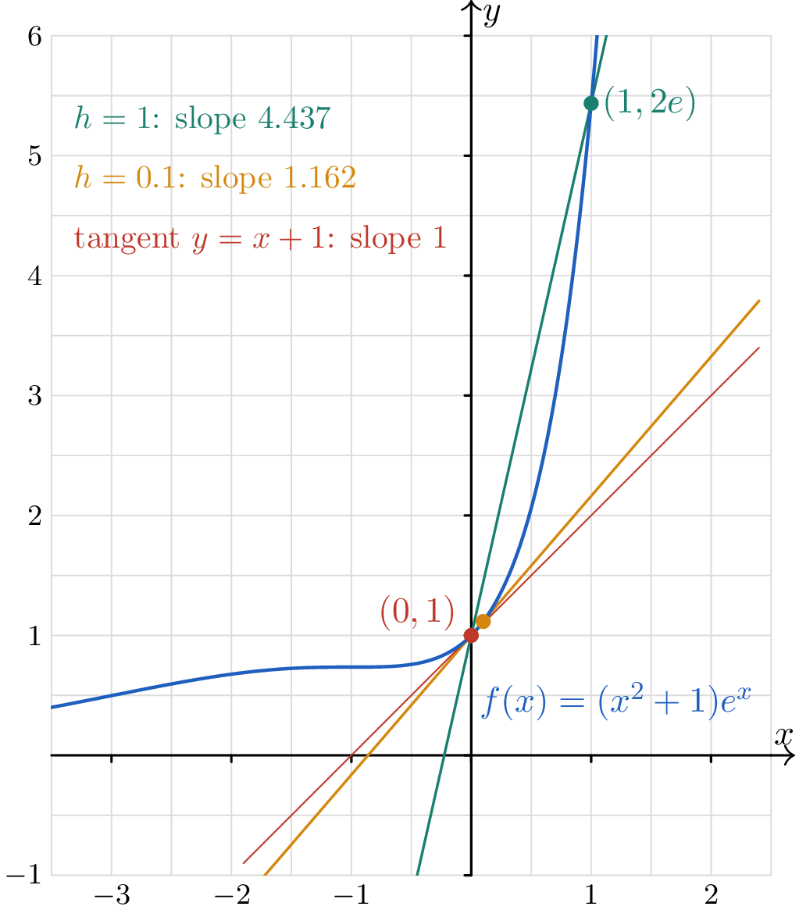

# Problem 15. The Difference Quotient as a Check of the Derivative

## Exercise

### Problem 15. The Difference Quotient as a Check of the Derivative
Choose one function from the problem set and a point $x_0$ at which the derivative exists. Compute $f'(x_0)$ exactly, and then calculate

$$
\frac{f(x_0+h)-f(x_0)}h
$$

for $h=1$, $0.1$, and $0.01$. Compare the values with $f'(x_0)$ and explain why the difference quotient approaching a single number is consistent with the definition of the derivative, while a few computations do not replace a limit argument.

> **Why this problem:** it connects the definition of the derivative with concrete calculations and teaches the distinction between observation and proof.

---

## Answer

**Choice.** The function from Problem 3, $f(x)=(x^2+1)e^x$, at the point $x_0=0$. It is differentiable everywhere, and

$$
f'(x)=(x+1)^2e^x,\qquad f'(0)=1
$$

**Difference quotients.** With $f(0)=1$ the quotient is $\frac{(h^2+1)e^h-1}h$.

| $h$ | $\frac{f(h)-f(0)}h$ | difference from $f'(0)=1$ |
|---|---|---|
| $1$ | $4.43656$ | $3.43656$ |
| $0.1$ | $1.16223$ | $0.16223$ |
| $0.01$ | $1.01512$ | $0.01512$ |

The quotients approach $1$, and the difference shrinks roughly in proportion to $h$. This agrees with the definition $f'(0)=\lim_{h\to0}\frac{f(h)-f(0)}h$. It does not prove it: three values say nothing about the infinitely many other $h$, and the limit is a statement about all $h$ close to $0$. The proof is the limit computation in Step 4.

---

## Sketch

The blue curve is $f(x)=(x^2+1)e^x$. The green and orange lines are the secants through $(0,1)$ and $(h,f(h))$ for $h=1$ (slope $4.437$) and $h=0.1$ (slope $1.162$). The red line is the tangent $y=x+1$ with slope $1$. The secant for $h=0.01$ is not drawn: at this scale it cannot be distinguished from the tangent.

---

## Steps

### Step 1. Exact derivative

By the product rule, as in Problem 3:

$$
f'(x)=2x\ e^x+(x^2+1)e^x=(x+1)^2e^x,\qquad f'(0)=1\cdot1=1
$$

### Step 2. The difference quotient

$$
\frac{f(0+h)-f(0)}h=\frac{(h^2+1)e^h-1}h
$$

### Step 3. Numerical values

| $h$ | $f(h)$ | $\frac{f(h)-1}h$ |
|---|---|---|
| $1$ | $2e\approx5.43656$ | $4.43656$ |
| $0.1$ | $1.01e^{0.1}\approx1.11622$ | $1.16223$ |
| $0.01$ | $1.0001e^{0.01}\approx1.01015$ | $1.01512$ |

The error decreases from about $3.4$ to $0.16$ to $0.015$: each tenfold decrease of $h$ makes it roughly ten times smaller for small $h$. The quotient for $h=1$ is far from $1$: the secant over a long interval reflects the average growth on $[0,1]$, not the slope at $0$.

### Step 4. The limit argument

Split the quotient:

$$
\frac{(h^2+1)e^h-1}h=\frac{e^h-1}h+h\ e^h
$$

The first term tends to $1$, the standard limit that expresses $\left(e^x\right)'=e^x$ at $x=0$. The second term tends to $0\cdot1=0$. Therefore

$$
\lim_{h\to0}\frac{f(h)-f(0)}h=1+0=1=f'(0)
$$

This holds for all $h\to0$, positive and negative, which is what the definition requires.

---

## Why it works

**Why the observation is consistent with the definition.** The definition states that the quotient gets arbitrarily close to $f'(0)$ when $h$ is close enough to $0$. If the computed quotients moved away from $1$, or approached a different number, the claimed value of $f'(0)$ would be wrong. The table is a test that the exact result passes.

**Why a few values are not a proof.**

1. A table contains finitely many values of $h$; the limit concerns every $h$ in an interval around $0$.
2. The values in the table are all positive. The two-sided limit also requires $h\lt0$; for the function of Problem 14 with $a=1$, positive $h$ alone would suggest the slope $0$, although the derivative does not exist.
3. A function can agree with a pattern at the tested points and deviate between them. For example $g(x)=\sin\frac{\pi}x$ satisfies $g\left(\frac1n\right)=0$ for every positive integer $n$, yet $g$ takes the values $\pm1$ arbitrarily close to $0$.
4. Rounding limits the information: for very small $h$ the numerator $f(h)-f(0)$ is a difference of nearly equal numbers, and a calculator loses digits.

**Observation and proof have different roles.**

| | Table of quotients | Limit argument |
|---|---|---|
| what it uses | a few chosen $h$ | all $h$ near $0$ |
| what it shows | the exact answer is plausible | the exact answer is correct |
| what it catches | arithmetic errors in $f'(x_0)$ | everything |

**The rate of approach.** The difference between the quotient and $f'(0)$ is about $\frac{f''(0)}2h$. Here $f''(x)=(x+1)(x+3)e^x$, so $f''(0)=3$ and the error is about $1.5h$, which matches $0.162$ for $h=0.1$ and $0.0151$ for $h=0.01$.

---

## Check

**Negative $h$.**

| $h$ | $-1$ | $-0.1$ | $-0.01$ |
|---|---|---|---|
| $\frac{f(h)-1}h$ | $0.26424$ | $0.86114$ | $0.98512$ |

From the left the quotients approach $1$ from below; from the right they approach it from above ✓.

**Smaller $h$.** For $h=0.001$ the quotient is $1.00150$, with error $0.0015\approx1.5h$ ✓.

**The value $f(1)$.** $f(1)=2e\approx5.43656$, so the quotient for $h=1$ is $5.43656-1=4.43656$ ✓.
